# SiapBanjir

**Aplikasi Prediksi dan Peringatan Risiko Banjir**

Tugas Kelompok 2 — Mata Kuliah Pengembangan Perangkat Lunak
Magister Ilmu Komputer, Universitas Gadjah Mada (2026)

<p align="center"></p>

## Anggota Kelompok

| Nama | NIM |
|------|-----|
| Assyfa Rasida Hanum | 26/585801/PPA/07339 |
| Xerxes Surya Fortuna | 26/589506/PPA/07361 |
| Hedi Suryadi | 26/590863/PPA/07419 |
| Akbar Syah Rianto | 26/591436/PPA/07451 |

## Daftar Isi

1. [Moore's Vision](#moores-vision)
2. [Persona](#persona)
3. [Kebutuhan Fungsional](#kebutuhan-fungsional)
4. [Deskripsi Perancangan](#deskripsi-perancangan)
5. [Kebutuhan Non-Fungsional](#kebutuhan-non-fungsional)
6. [Traceability](#traceability)
7. [Prototype Software](#prototype-software)
8. [Security and Privacy](#security-and-privacy)
9. [Kontribusi Anggota](#kontribusi-anggota)
10. [Daftar Pustaka](#daftar-pustaka)
11. [Lampiran](#lampiran)

---

# Moore's Vision

**SIAPBANJIR: Aplikasi Prediksi dan Peringatan Risiko Banjir**

| Elemen | Isi |
|---|---|
| **FOR (Target Pengguna)** | Masyarakat di daerah berpotensi banjir, seperti dataran rendah dan bantaran sungai. |
| **WHO (Kebutuhan/Masalah)** | Sulit mendapat informasi dini potensi banjir yang tepat waktu dan mudah dipahami, sehingga tidak tau apa yang harus disiapkan. |
| **THE PRODUCT (Kategori Produk)** | **SiapBanjir**, layanan peringatan dini risiko banjir |
| **THAT ( Value Proposition Utama)** | Memberi tahu tingkat risiko banjir di lokasi pengguna lebih awal, lengkap dengan peringatan dan rekomendasi tindakan yang mudah dipahami |
| **UNLIKE (Kompetitor/Alternatif)** | Informasi cuaca umum yang hanya menyajikan angka curah hujan atau prakiraan per wilayah administratif, tanpa menerjemahkannya menjadi tingkat risiko banjir dan tindakan untuk lokasi pengguna. |
| **OUR PRODUCT (Diferensiator Utama)** | Menyampaikan risiko banjir dalam tiga tingkat (rendah,sedang,tinggi) dengan bahasa awam, lengkap dengan langkah persiapan, tanpa perlu analisis manual. |

**Alur Nilai Produk**

1.  Open-Meteo → Data cuaca dan curah hujan

2.  SiapBanjir → Analisis data dengan aturan ambang batas curah hujan

3.  Prediksi → Estimasi tingkat risiko banjir untuk wilayah yang dipilih

4.  Peringatan → Risiko rendah, sedang, atau tinggi

5.  Tindakan → Rekomendasi persiapan yang sesuai dengan tingkat risiko

**Contoh Rekomendasi Berdasarkan Risiko**

1.  **Risiko Rendah:** Memantau perkembangan cuaca, mengaktifkan notifikasi, dan memastikan saluran air tidak tersumbat.

2.  **Risiko Sedang:** Memantau peringatan secara berkala, mengamankan dokumen dan barang penting, serta menyiapkan kebutuhan darurat.

3.  **Risiko Tinggi:** Memantau arahan resmi, mengamankan barang penting, bersiap menuju lokasi aman jika ada instruksi evakuasi, dan menghindari wilayah yang tergenang.

**Inti Produk: Data Cuaca → Analisis → Prediksi Risiko → Peringatan → Rekomendasi Tindakan**

### Ruang Lingkup Fitur

Visi di atas disusun dengan format Moore’s Vision (Moore, 2014). Agar realistis untuk dikerjakan dalam satu semester, fitur SiapBanjir dibatasi seperti pada Tabel 1. Fitur di kolom kanan sengaja tidak dikerjakan sekarang dan dicatat sebagai peluang pengembangan.

*Tabel 1 Ruang Lingkup Fitur SiapBanjir*

| **In-Scope (dikerjakan semester ini)**                                          | **Out-of-Scope (tidak dikerjakan)**                          |
|---------------------------------------------------------------------------------|--------------------------------------------------------------|
| F-01 Pemilihan wilayah pantauan                                                 | Prediksi risiko berbasis model data historis kejadian banjir |
| F-02 Data cuaca terkini dan prakiraan curah hujan per jam dari Open-Meteo       | Integrasi data debit dan tinggi muka air sungai              |
| F-03 Level risiko rendah, sedang, dan tinggi dengan (ambang batas)              | Riwayat kejadian banjir dan grafik historis                  |
| F-04 Persiapan dini dan rekomendasi tindakan                                    | Akun pengguna dan panel admin pengelola konten               |
| F-05 Informasi kebencanaan dan kerawanan banjir per wilayah                     | Notifikasi melalui SMS atau WhatsApp                         |
| F-06 Notifikasi push browser (Web Push) yang dapat diaktifkan dan dinonaktifkan | Aplikasi native Android dan iOS                              |
| F-07 Pembaruan data dan level risiko otomatis setiap 60 menit                   | Perintah evakuasi resmi, yang tetap menjadi wewenang BPBD    |

### Catatan Perubahan Scope

Dibandingkan rancangan awal, ruang lingkup SiapBanjir disusun ulang menjadi dua kelompok. Kelompok pertama adalah kebutuhan inti (in-scope), yaitu pemilihan wilayah pantauan (F-01), data cuaca dan prakiraan hujan per jam dari Open-Meteo (F-02), level risiko rendah, sedang, dan tinggi berdasarkan aturan ambang batas (F-03), persiapan dini dan rekomendasi tindakan (F-04), informasi kebencanaan dan kerawanan per wilayah (F-05), notifikasi push browser (F-06), serta pembaruan otomatis setiap 60 menit (F-07). Kelompok kedua adalah kebutuhan yang tidak dikerjakan (out-of-scope), yaitu prediksi risiko berbasis model data historis kejadian banjir, integrasi data debit dan tinggi muka air sungai, riwayat kejadian banjir dan grafik historis, akun pengguna dan panel admin pengelola konten, notifikasi multi-kanal melalui SMS dan pesan instan, aplikasi mobile, serta integrasi informasi dan arahan resmi dari BPBD.

Kebutuhan out-of-scope tidak dikerjakan pada tahap ini, tetapi tetap dicatat sebagai peluang pengembangan sistem ke depan. Prediksi berbasis model data historis tidak dikerjakan karena data kejadian banjir yang sudah berlabel per wilayah belum tersedia, sehingga hasilnya belum dapat divalidasi. Sebagai gantinya, kebutuhan inti memakai aturan ambang batas curah hujan yang transparan, mudah diuji, dan nilainya dapat diubah tanpa mengubah kode. Riwayat kejadian banjir dan grafik historis juga ditempatkan di luar lingkup karena belum memiliki use case maupun functional requirement pada rancangan saat ini. Batas pengerjaan yang lebih rinci untuk setiap kebutuhan ditetapkan pada tahap implementasi.

---

# Persona

## Ibu Sri Wahyuni

### 1.1 Persona

| **Nama**                | Ibu Sri Wahyuni (42 tahun)                                                                   |
|-------------------------|----------------------------------------------------------------------------------------------|
| **Pekerjaan**           | Ibu rumah tangga, suami bekerja sebagai buruh harian                                         |
| **Lokasi**              | Tinggal di bantaran Sungai Code, Yogyakarta                                                  |
| **Latar Belakang**      | Sudah 3 kali mengalami banjir dalam 5 tahun terakhir, punya 2 anak usia sekolah              |
| **Kemampuan Teknologi** | Menengah, terbiasa pakai WhatsApp dan media sosial, tidak terlalu paham istilah teknis cuaca |

### 1.2 Skenario

> Musim hujan tiba dan Bu Sri sering merasa cemas setiap kali hujan turun deras di malam hari, karena dulu banjir datang tiba-tiba tanpa peringatan yang jelas. Ia hanya mengandalkan suara warga yang teriak-teriak atau kentongan sebagai tanda bahaya.
>
> Ia ingin tahu lebih awal, sejak sore hari, apakah malam ini berisiko banjir atau tidak, supaya bisa menyiapkan barang-barang penting dan anak-anaknya sebelum air naik.

### 1.3 Narasi Pengguna

> *Nama saya Sri Wahyuni, umur saya 42 tahun. Saya sudah tinggal di rumah ini, di pinggir Sungai Code, sejak menikah dengan suami saya 18 tahun yang lalu. Rumah ini warisan dari orang tua suami saya, jadi meskipun tahu daerah ini rawan banjir, kami tidak punya pilihan lain untuk pindah karena keterbatasan ekonomi. Suami saya bekerja sebagai buruh harian, penghasilannya pas-pasan untuk kebutuhan sehari-hari dan biaya sekolah dua anak kami yang masih SD dan SMP.*
>
> *Selama tinggal di sini, sudah tiga kali rumah kami kena banjir. Yang paling parah tahun lalu, air masuk sampai setinggi lutut orang dewasa, dan kami harus mengungsi tengah malam dalam keadaan panik karena tidak ada peringatan sama sekali. Barang-barang penting seperti ijazah anak dan surat-surat berharga basah karena tidak sempat diselamatkan. Sejak itu, setiap kali mendengar hujan deras di malam hari, saya jadi susah tidur, was-was terus memikirkan anak-anak.*
>
> *Masalahnya, saya tidak paham istilah-istilah cuaca yang rumit seperti milimeter curah hujan atau apa itu prakiraan. Saya juga tidak tahu harus melihat informasi dari mana yang bisa dipercaya dan mudah dimengerti. Yang saya butuhkan sederhana saja: saya ingin tahu lebih awal, sejak sore hari, apakah malam nanti berbahaya atau tidak, dan apa yang harus saya siapkan supaya saya tidak lagi panik dan kehilangan barang-barang penting seperti tahun lalu.*

## Pak Bambang Sutrisno

### 2.1 Persona

| **Nama**                | Pak Bambang Sutrisno (55 tahun)                                                                   |
|-------------------------|---------------------------------------------------------------------------------------------------|
| **Pekerjaan**           | Ketua RT sekaligus koordinator relawan siaga bencana di wilayahnya                                |
| **Lokasi**              | Kelurahan dataran rendah dekat aliran sungai                                                      |
| **Latar Belakang**      | Bertanggung jawab mengkoordinasikan evakuasi warga saat banjir, sering rapat dengan BPBD setempat |
| **Kemampuan Teknologi** | Cukup mahir, menggunakan laptop dan grup WhatsApp RT untuk menyebarkan informasi                  |

### 2.2 Skenario

> Setiap musim hujan, Pak Bambang harus memantau kondisi cuaca dan curah hujan secara manual dari berbagai sumber (BMKG, grup WA, kabar dari RT tetangga) untuk memutuskan kapan harus menghimbau warga bersiap atau mengaktifkan posko evakuasi.
>
> Proses ini memakan waktu dan sering terlambat karena informasi yang simpang siur. Ia butuh satu sumber data yang jelas dan cepat untuk mengambil keputusan serta menyebarkan ke warga melalui grup RT.

### 2.3 Narasi Pengguna

> *Saya Bambang Sutrisno, sudah 55 tahun, dan sudah menjabat sebagai Ketua RT di lingkungan ini selama hampir 10 tahun. Dulu saya bekerja sebagai pegawai swasta, tapi setelah pensiun dini saya lebih fokus mengabdi untuk warga di sini, terutama karena wilayah kami termasuk langganan banjir setiap musim hujan. Selain jadi Ketua RT, saya juga dipercaya menjadi koordinator relawan siaga bencana, jadi kalau ada tanda-tanda banjir, sayalah yang biasanya paling dulu dihubungi warga maupun pihak BPBD.*
>
> *Tanggung jawab ini berat, karena keputusan saya menentukan apakah warga harus segera mengungsi atau belum. Selama ini, saya mengandalkan informasi dari berbagai sumber, kadang dari grup WhatsApp antar-RT, kadang dari siaran BMKG, kadang bahkan cuma dari kabar mulut ke mulut warga di hulu sungai. Masalahnya, informasi-informasi ini sering simpang siur dan tidak sinkron satu sama lain, sehingga saya kerap terlambat mengambil keputusan. Pernah suatu kali saya baru mengumumkan siaga banjir lewat pengeras masjid, eh ternyata air sudah keburu naik duluan dan beberapa warga lansia kesulitan dievakuasi karena waktunya terlalu mepet.*
>
> *Saya sebenarnya cukup terbiasa pakai laptop dan gadget untuk kerja RT sehari-hari, jadi bukan soal gaptek. Yang saya butuhkan adalah satu sumber informasi yang jelas dan bisa saya percaya, spesifik untuk wilayah RT saya, supaya saya bisa lebih cepat dan lebih yakin dalam memutuskan kapan harus mengaktifkan posko dan menghimbau warga untuk bersiap-siap, sebelum semuanya terlambat.*

## Andika Pratama

### 3.1 Persona

| **Nama**                | Andika Pratama (21 tahun)                                                                       |
|-------------------------|-------------------------------------------------------------------------------------------------|
| **Pekerjaan**           | Mahasiswa semester 5, kost di dekat kampus yang kebetulan berada di daerah rawan genangan       |
| **Lokasi**              | Baru pindah dari luar kota, belum familiar dengan karakteristik daerah setempat                 |
| **Latar Belakang**      | Tidak tahu daerah kosnya rawan banjir sampai mengalami sendiri motornya terendam                |
| **Kemampuan Teknologi** | Tinggi, terbiasa pakai berbagai aplikasi dan lebih suka aplikasi yang praktis serta minim ribet |

### 3.2 Skenario

> Andika baru pindah ke kota untuk kuliah dan belum tahu bahwa area kosnya termasuk rawan banjir saat hujan deras. Suatu malam, hujan turun sangat deras dan ia tidak menyadari risikonya sampai air mulai masuk ke kos dan motornya terendam di parkiran.
>
> Ia menyesal tidak dapat informasi ini lebih awal dan ingin ada cara praktis untuk memantau risiko di lokasi tempat tinggal nya sehari-hari, terutama karena ia sering pulang malam dari kampus.

### 3.3 Narasi Pengguna

> *Nama saya Andika Pratama, umur 21 tahun, sekarang kuliah semester 5 di jurusan Teknik. Saya berasal dari luar kota, dan baru pindah ke Yogyakarta sekitar dua tahun lalu untuk melanjutkan kuliah. Karena masih perantauan, saya belum begitu kenal seluk-beluk daerah sini, termasuk mana wilayah yang rawan bencana. Saya memilih kos yang dekat kampus supaya praktis, tanpa tahu ternyata daerah itu termasuk langganan genangan air kalau hujan deras.*
>
> *Waktu itu saya masih ingat betul, malam itu saya baru pulang dari kampus karena ada tugas kelompok yang molor sampai malam. Hujan turun sangat deras, tapi saya kira itu hujan biasa saja seperti malam-malam sebelumnya. Saya santai saja mengerjakan tugas di kamar sambil dengar musik, tidak sadar air sudah mulai naik di luar. Baru sadar ketika teman kos saya menggedor pintu bilang air sudah masuk ke area parkiran. Saya buru-buru keluar, tapi sudah terlambat, motor saya terendam air setengah roda, dan beberapa barang elektronik saya yang ditaruh di bawah ranjang ikut basah.*
>
> *Sejak kejadian itu saya jadi parno tiap kali hujan deras turun di malam hari, apalagi kalau saya masih di kampus atau sedang di luar. Saya terbiasa pakai HP untuk hampir semua hal, jadi saya berharap ada cara praktis untuk mengecek risiko banjir di sekitar kos saya secara cepat, supaya kalau memang berbahaya, saya bisa langsung pulang lebih awal atau setidaknya mengamankan motor dan barang-barang saya sebelum semuanya terlambat lagi seperti malam itu.*

---

# Kebutuhan Fungsional

Bagian ini menurunkan kebutuhan ketiga persona menjadi user story, acceptance criteria, dan functional requirement (FR). Setiap user story diberi kode US dan setiap kebutuhan diberi kode FR. Kedua kode ini dipakai kembali pada tabel traceability.

## 1. User Story

User story ditulis dengan pola “Sebagai …, saya ingin …, agar …”, yang merupakan padanan dari pola As a … I want … so that …. Daftar lengkapnya disajikan pada Tabel 2.

*Tabel 2 Daftar User Story*

| **Kode** | **User Story**                                                                                                                                                                                                         | **Persona**    | **FR Terkait** |
|----------|------------------------------------------------------------------------------------------------------------------------------------------------------------------------------------------------------------------------|----------------|----------------|
| US-01    | **Sebagai** pengguna, **saya ingin** memilih wilayah tempat tinggal dan pilihan itu tersimpan di perangkat, **agar** informasi risiko yang saya lihat selalu sesuai lokasi rumah tanpa harus memilih ulang.            | Bu Sri         | FR-01          |
| US-02    | **Sebagai** pengguna, **saya ingin** melihat level risiko banjir wilayah saya dalam bentuk rendah, sedang, atau tinggi, **agar** sejak sore saya tahu apakah malam nanti berbahaya tanpa perlu memahami istilah cuaca. | Bu Sri         | FR-04, FR-05   |
| US-03    | **Sebagai** pengguna, **saya ingin** menerima notifikasi ketika risiko naik menjadi sedang atau tinggi, **agar** saya bisa bersiap walau sedang tidak membuka aplikasi.                                                | Bu Sri, Andika | FR-09          |
| US-04    | **Sebagai** pengguna, **saya ingin** melihat daftar persiapan dini sesuai level risiko, **agar** tahu barang apa yang harus diamankan lebih dulu, misalnya ijazah dan surat berharga.                                  | Bu Sri         | FR-06          |
| US-05    | **Sebagai** pengguna, **saya ingin** melihat rekomendasi tindakan sesuai level risiko wilayah RT, **agar** lebih cepat memutuskan kapan menghimbau warga bersiap atau mengaktifkan posko.                              | Pak Bambang    | FR-07          |
| US-06    | **Sebagai** pengguna, **saya ingin** melihat data cuaca terkini dan prakiraan curah hujan beserta waktu pembaruannya, **agar** punya satu sumber informasi yang jelas untuk diteruskan ke grup WhatsApp warga.         | Pak Bambang    | FR-02, FR-03   |
| US-07    | **Sebagai** pengguna, **saya ingin** membaca informasi kerawanan banjir di wilayah kos, **agar** saya memahami karakter daerah yang belum saya kenal.                                                                  | Andika         | FR-10          |
| US-08    | **Sebagai** pengguna, **saya ingin** mengaktifkan atau menonaktifkan notifikasi di perangkat, **agar** menerima peringatan hanya ketika saya membutuhkannya.                                                           | Andika         | FR-08          |
| US-09    | **Sebagai** pengguna, **saya ingin** data cuaca dan level risiko diperbarui otomatis secara berkala, **agar** informasi yang saya lihat tidak kedaluwarsa.                                                             | Semua persona  | FR-11          |

## 2. Acceptance Criteria

Acceptance criteria ditulis dengan format Given-When-Then untuk tiga story utama, yaitu US-01, US-02, dan US-03. Ketiganya dipilih karena menjadi inti nilai produk, yaitu memilih lokasi, memahami risiko, dan menerima peringatan. Setiap kriteria dapat diuji langsung oleh penguji.

*Tabel 3 Acceptance Criteria US-01 (Memilih Wilayah)*

| **Kode** | **Given**                                                          | **When**                                               | **Then**                                                                                            |
|----------|--------------------------------------------------------------------|--------------------------------------------------------|-----------------------------------------------------------------------------------------------------|
| AC-01.1  | Pengguna membuka SiapBanjir pertama kali dan belum memilih wilayah | Pengguna memilih Kelurahan X dari daftar wilayah       | Sistem menampilkan data cuaca dan level risiko Kelurahan X, lalu menyimpan pilihan itu di perangkat |
| AC-01.2  | Pengguna sudah pernah memilih Kelurahan X                          | Pengguna membuka SiapBanjir kembali                    | Sistem langsung menampilkan Kelurahan X tanpa meminta pengguna memilih ulang                        |
| AC-01.3  | Pengguna sedang memantau Kelurahan X                               | Pengguna mencari nama wilayah yang tidak ada di daftar | Sistem menampilkan pesan “Wilayah belum tersedia” dan wilayah pantauan tetap Kelurahan X            |

*Tabel 4 Acceptance Criteria US-02 (Melihat Level Risiko)*

| **Kode** | **Given**                                                                   | **When**                   | **Then**                                                                                     |
|----------|-----------------------------------------------------------------------------|----------------------------|----------------------------------------------------------------------------------------------|
| AC-02.1  | Prakiraan akumulasi hujan 24 jam ke depan di wilayah terpilih sebesar 30 mm | Halaman risiko ditampilkan | Sistem menampilkan level Rendah berwarna hijau dengan kalimat penjelasan dalam bahasa awam   |
| AC-02.2  | Prakiraan akumulasi hujan 24 jam ke depan sebesar 75 mm                     | Halaman risiko ditampilkan | Sistem menampilkan level Sedang berwarna kuning dengan kalimat penjelasan dalam bahasa awam  |
| AC-02.3  | Prakiraan akumulasi hujan 24 jam ke depan sebesar 120 mm                    | Halaman risiko ditampilkan | Sistem menampilkan level Tinggi berwarna merah dengan kalimat penjelasan dalam bahasa awam   |
| AC-02.4  | Open-Meteo tidak merespons dalam 10 detik                                   | Halaman risiko ditampilkan | Sistem menampilkan level terakhir yang tersimpan beserta keterangan waktu pembaruan terakhir |

*Tabel 5 Acceptance Criteria US-03 (Menerima Notifikasi)*

| **Kode** | **Given**                                                                                      | **When**                                                  | **Then**                                                                                                      |
|----------|------------------------------------------------------------------------------------------------|-----------------------------------------------------------|---------------------------------------------------------------------------------------------------------------|
| AC-03.1  | Notifikasi aktif di perangkat pengguna untuk Kelurahan X dan level terakhir wilayah itu Rendah | Pembaruan terjadwal menghasilkan level Sedang atau Tinggi | Sistem mengirim notifikasi berisi nama wilayah, level risiko, dan satu tindakan utama                         |
| AC-03.2  | Notifikasi level Tinggi sudah terkirim untuk Kelurahan X                                       | Pembaruan berikutnya masih menghasilkan level Tinggi      | Sistem tidak mengirim notifikasi ulang                                                                        |
| AC-03.3  | Pengguna menolak izin notifikasi di browser                                                    | Level risiko Kelurahan X naik menjadi Tinggi              | Tidak ada notifikasi ke perangkat tersebut, tetapi level Tinggi tetap tampil saat pengguna membuka SiapBanjir |
| AC-03.4  | Pengguna menerima notifikasi peringatan                                                        | Pengguna mengetuk notifikasi                              | SiapBanjir terbuka di halaman persiapan dini dan rekomendasi untuk wilayah tersebut                           |

## 3. Functional Requirements

Tabel 6 memuat kebutuhan fungsional SiapBanjir. Setiap FR memiliki pasangan use case pada bagian Deskripsi Perancangan, sehingga tidak ada use case yang berdiri tanpa kebutuhan dan sebaliknya.

*Tabel 6 Daftar Functional Requirements*

| **Kode** | **Kebutuhan Fungsional**                                                                                                                                                         | **Use Case** |
|----------|----------------------------------------------------------------------------------------------------------------------------------------------------------------------------------|--------------|
| FR-01    | Sistem menyediakan daftar wilayah pantauan, memungkinkan pengguna memilih satu wilayah, dan menyimpan pilihan itu di perangkat.                                                  | UC-01        |
| FR-02    | Sistem mengambil data cuaca (curah hujan, suhu, kelembapan, kecepatan angin) dan prakiraan curah hujan per jam dari Open-Meteo berdasarkan koordinat wilayah.                    | UC-09        |
| FR-03    | Sistem menampilkan data cuaca terkini dan prakiraan curah hujan wilayah terpilih beserta waktu pembaruan data.                                                                   | UC-03        |
| FR-04    | Sistem menghitung level risiko banjir (rendah, sedang, tinggi) dengan membandingkan akumulasi prakiraan hujan 24 jam terhadap tabel AmbangRisiko.                                | UC-10        |
| FR-05    | Sistem menampilkan level risiko dengan label, warna, dan penjelasan dalam bahasa awam.                                                                                           | UC-04        |
| FR-06    | Sistem menampilkan daftar persiapan dini sesuai level risiko wilayah.                                                                                                            | UC-05        |
| FR-07    | Sistem menampilkan rekomendasi tindakan sesuai level risiko wilayah.                                                                                                             | UC-06        |
| FR-08    | Sistem meminta izin notifikasi browser serta memungkinkan pengguna mengaktifkan dan menonaktifkan langganan notifikasi untuk wilayah terpilih.                                   | UC-02        |
| FR-09    | Sistem mengirim notifikasi push ke perangkat yang berlangganan ketika level risiko wilayah naik menjadi sedang atau tinggi, dan tidak mengirim ulang selama level tidak berubah. | UC-08        |
| FR-10    | Sistem menampilkan informasi umum kebencanaan dan kerawanan banjir wilayah.                                                                                                      | UC-07        |
| FR-11    | Sistem memperbarui data cuaca dan menghitung ulang level risiko setiap wilayah secara otomatis setiap 60 menit.                                                                  | UC-09, UC-10 |

## 4. Aturan Penentuan Level Risiko

Level risiko dihitung dari jumlah prakiraan curah hujan per jam untuk 24 jam ke depan yang diambil dari Open-Meteo Weather Forecast API (Open-Meteo, t.t.-b). Hasil penjumlahan dibandingkan dengan tabel AmbangRisiko. Batas awal mengacu pada kategori intensitas hujan harian yang dipakai BMKG, yaitu hujan ringan 0,5 sampai 20 mm per hari, sedang 20 sampai 50 mm, lebat 50 sampai 100 mm, sangat lebat 100 sampai 150 mm, dan ekstrem di atas 150 mm per hari (Tempo.co, t.t.). BMKG juga menegaskan bahwa hujan di atas 150 mm per hari secara klimatologis sudah tergolong ekstrem (BMKG, 2025).

*Tabel 7 Aturan Penentuan Level Risiko*

| **Level Risiko** | **Akumulasi Prakiraan Hujan 24 Jam** | **Kategori Hujan BMKG yang Dirujuk**                                          | **Warna** |
|------------------|--------------------------------------|-------------------------------------------------------------------------------|-----------|
| Rendah           | Kurang dari 50 mm                    | Hujan ringan (0,5 sampai 20 mm/hari) dan sedang (20 sampai 50 mm/hari)        | Hijau     |
| Sedang           | 50 sampai kurang dari 100 mm         | Hujan lebat (50 sampai 100 mm/hari)                                           | Kuning    |
| Tinggi           | 100 mm atau lebih                    | Hujan sangat lebat (100 sampai 150 mm/hari) dan ekstrem (di atas 150 mm/hari) | Merah     |

Perlu dicatat bahwa kategori BMKG di atas adalah kategori intensitas hujan, bukan ambang resmi kejadian banjir. Karena itu nilai pada Tabel 7 diperlakukan sebagai asumsi awal. Nilainya disimpan di basis data sehingga dapat dikalibrasi, misalnya dengan data kejadian banjir dari BPBD, tanpa mengubah kode program.

---

# Deskripsi Perancangan

## Pemodelan UML dan Arsitektur

### 1.1 Use Case Diagram

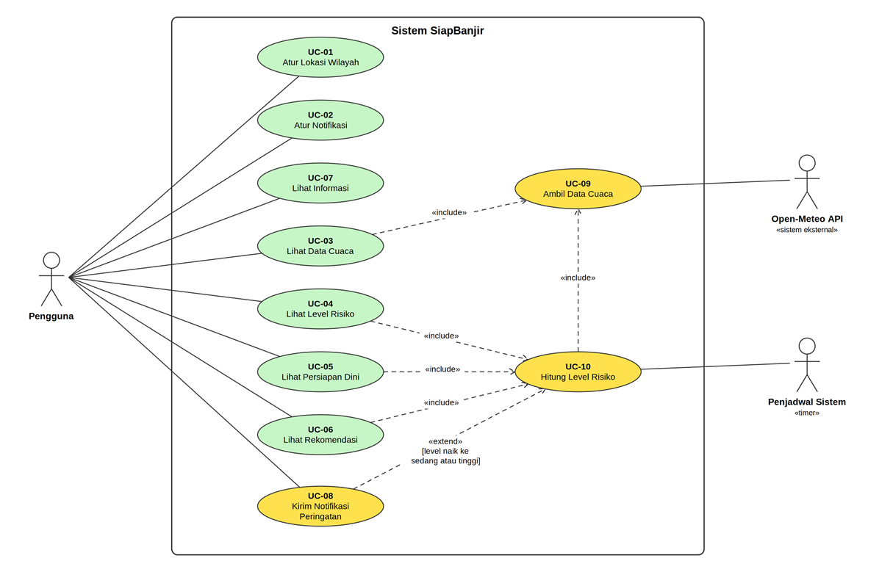

*Gambar 1 Use Case Diagram SiapBanjir*

Use case diagram pada Gambar 1 menggambarkan interaksi antara aktor dengan sistem SiapBanjir. Kotak besar merupakan batas sistem (system boundary), sedangkan aktor berada di luar kotak. Setiap use case diberi kode UC-01 sampai UC-10 agar mudah ditelusuri ke user story, functional requirement, dan komponen pada tabel traceability.

### Deskripsi Aktor

Terdapat empat aktor yang terlibat dalam sistem. Pengguna adalah aktor utama, sedangkan Penjadwal Sistem, Open-Meteo API, dan Layanan Web Push adalah aktor sekunder. Penjelasan masing-masing aktor disajikan pada Tabel 8.

*Tabel 8 Deskripsi Aktor*

| **No** | **Nama**         | **Jenis**                         | **Deskripsi**                                                                                                                                                                                |
|--------|------------------|-----------------------------------|----------------------------------------------------------------------------------------------------------------------------------------------------------------------------------------------|
| 1      | Pengguna         | Aktor utama                       | Masyarakat yang memakai SiapBanjir, yaitu warga bantaran sungai, ketua RT, dan mahasiswa perantau sesuai persona. Pengguna memulai sebagian besar interaksi dan menjadi penerima notifikasi. |
| 2      | Penjadwal Sistem | Aktor sekunder (timer)            | Pemicu berbasis waktu yang menjalankan perhitungan level risiko setiap 60 menit tanpa menunggu pengguna membuka website.                                                                     |
| 3      | Open-Meteo API   | Aktor sekunder (sistem eksternal) | Layanan API cuaca yang menyediakan data cuaca terkini dan prakiraan curah hujan per jam berdasarkan koordinat.                                                                               |
| 4      | Layanan Web Push | Aktor sekunder (sistem eksternal) | Layanan push milik penyedia browser yang meneruskan notifikasi dari server ke perangkat pengguna.                                                                                            |

### Deskripsi Use Case Pengguna

Use case berwarna hijau merupakan fungsi yang diakses langsung oleh Pengguna. Penjelasannya disajikan pada Tabel 9 lengkap dengan kode FR yang memenuhinya.

*Tabel 9 Deskripsi Use Case Pengguna*

| **Kode** | **Nama**             | **Deskripsi**                                                                                                                                                        | **FR** |
|----------|----------------------|----------------------------------------------------------------------------------------------------------------------------------------------------------------------|--------|
| UC-01    | Atur Lokasi Wilayah  | Pengguna memilih wilayah yang ingin dipantau. Pilihan disimpan di perangkat sehingga data cuaca dan level risiko langsung menyesuaikan saat aplikasi dibuka kembali. | FR-01  |
| UC-02    | Atur Notifikasi      | Pengguna mengizinkan atau menolak notifikasi, serta dapat mengaktifkan dan menonaktifkan langganan notifikasi untuk wilayah terpilih.                                | FR-08  |
| UC-03    | Lihat Data Cuaca     | Pengguna melihat curah hujan, suhu, kelembapan, kecepatan angin, dan prakiraan hujan beserta waktu pembaruan data.                                                   | FR-03  |
| UC-04    | Lihat Level Risiko   | Pengguna melihat level risiko banjir wilayahnya (rendah, sedang, atau tinggi) lengkap dengan warna dan penjelasan singkat.                                           | FR-05  |
| UC-05    | Lihat Persiapan Dini | Pengguna melihat langkah antisipasi yang perlu dilakukan sesuai level risiko saat ini.                                                                               | FR-06  |
| UC-06    | Lihat Rekomendasi    | Pengguna melihat saran tindakan yang disesuaikan dengan level risiko.                                                                                                | FR-07  |
| UC-07    | Lihat Informasi      | Pengguna membaca informasi umum kebencanaan dan kerawanan banjir wilayah.                                                                                            | FR-10  |

### Deskripsi Use Case Sistem

Use case berwarna kuning merupakan proses yang dijalankan oleh sistem dan melibatkan aktor sekunder. UC-08 tetap terhubung dengan Pengguna karena Pengguna adalah penerima notifikasi. Penjelasannya disajikan pada Tabel 10.

*Tabel 10 Deskripsi Use Case Sistem*

| **Kode** | **Nama**                    | **Deskripsi**                                                                                                                                                                                    | **FR**       |
|----------|-----------------------------|--------------------------------------------------------------------------------------------------------------------------------------------------------------------------------------------------|--------------|
| UC-08    | Kirim Notifikasi Peringatan | Sistem membuat notifikasi dan mengirimkannya melalui Layanan Web Push ke perangkat yang berlangganan ketika level risiko naik menjadi sedang atau tinggi.                                        | FR-09        |
| UC-09    | Ambil Data Cuaca            | Sistem meminta data cuaca dan prakiraan curah hujan per jam ke Open-Meteo berdasarkan koordinat wilayah, lalu menyimpannya.                                                                      | FR-02, FR-11 |
| UC-10    | Hitung Level Risiko         | Sistem menjumlahkan prakiraan hujan 24 jam dan membandingkannya dengan tabel AmbangRisiko. Proses ini berjalan saat pengguna membuka halaman risiko dan dipicu Penjadwal Sistem setiap 60 menit. | FR-04, FR-11 |

### Relasi Antar-Use Case

**UC-03 Lihat Data Cuaca «include» UC-09 Ambil Data Cuaca.** Setiap kali pengguna melihat data cuaca, sistem harus memastikan data tersedia dari Open-Meteo. Relasi «include» menunjukkan bahwa use case tambahan selalu dijalankan setiap kali use case dasar berjalan.

**UC-04, UC-05, dan UC-06 «include» UC-10 Hitung Level Risiko.** Level risiko, persiapan dini, dan rekomendasi hanya bisa ditampilkan setelah level risiko wilayah diketahui, sehingga ketiganya selalu memakai hasil UC-10.

**UC-10 Hitung Level Risiko «include» UC-09 Ambil Data Cuaca.** Perhitungan risiko selalu membutuhkan data prakiraan hujan terbaru.

**UC-08 Kirim Notifikasi Peringatan «extend» UC-10 Hitung Level Risiko.** Notifikasi bersifat opsional dan hanya dijalankan pada kondisi tertentu, yaitu ketika hasil perhitungan menunjukkan level risiko naik menjadi sedang atau tinggi.

### Alur Penggunaan Sistem

Secara umum, alur penggunaan aplikasi Siap Banjir berdasarkan use case diagram adalah sebagai berikut.

1. Pengguna memilih wilayah yang ingin dipantau (UC-01).
2. Sistem menampilkan permintaan izin notifikasi. Jika diizinkan, perangkat didaftarkan sebagai pelanggan notifikasi wilayah tersebut (UC-02).
3. Sistem mengambil data cuaca dari Open-Meteo bila data tersimpan sudah berumur lebih dari 60 menit (UC-09).
4. Sistem menghitung level risiko banjir wilayah (UC-10). Perhitungan yang sama juga dijalankan Penjadwal Sistem setiap 60 menit.
5. Jika level risiko naik menjadi sedang atau tinggi, sistem mengirim notifikasi peringatan melalui Layanan Web Push (UC-08).
6. Pengguna melihat data cuaca, level risiko, persiapan dini, rekomendasi, dan informasi wilayah (UC-03 sampai UC-07).

### 1.2 Class Diagram

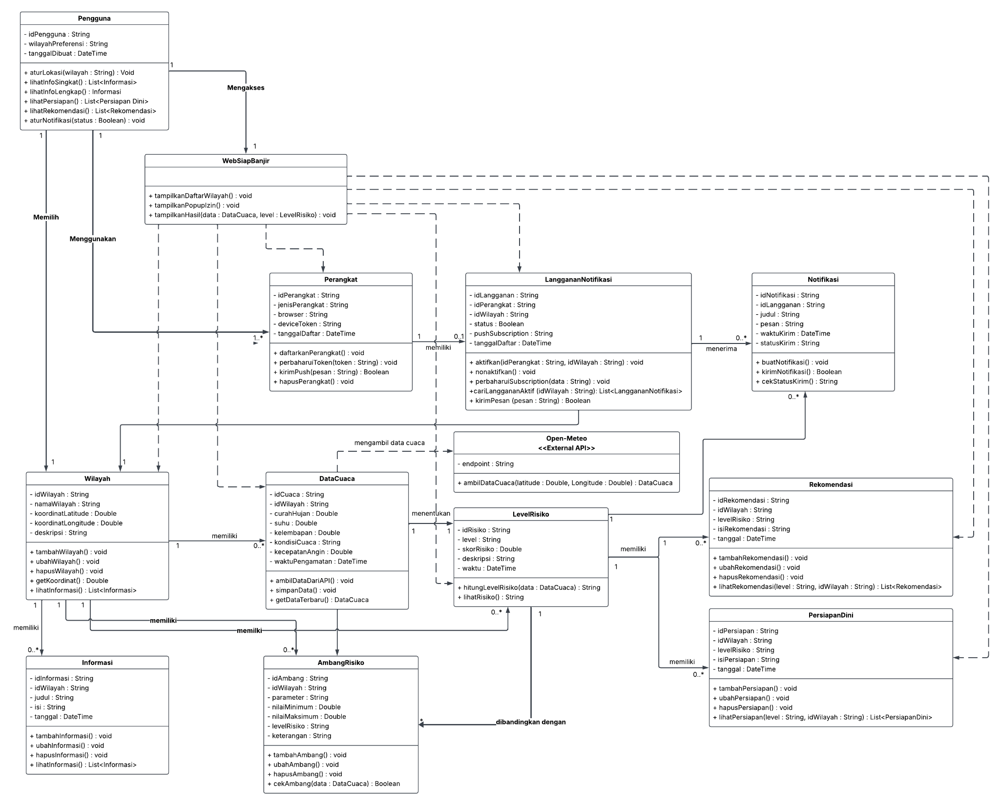

*Gambar 2 Class Diagram SiapBanjir*

### Deskripsi

Class diagram ini menggambarkan struktur statis sistem SiapBanjir yang terdiri atas dua belas kelas utama ditambah satu antarmuka API eksternal (Open-Meteo) beserta atribut, operasi, dan relasi antar kelas, yang merepresentasikan entitas-entitas yang terlibat dalam proses deteksi dan peringatan risiko banjir.

Kelas **Pengguna** memiliki atribut *idPengguna*, *wilayahPreferensi*, dan *tanggalDibuat*, dengan operasi seperti *aturLokasi()*, *lihatInfoSingkat()*, *lihatInfoLengkap()*, *lihatPersiapan()*, *lihatRekomendasi()*, dan *aturNotifikasi()*. Kelas ini berelasi dengan kelas **WebSiapBanjir** melalui relasi *dependency* "Mengakses", serta berelasi langsung dengan kelas **Wilayah** (relasi "Memilih") dan kelas **Perangkat** (relasi "Menggunakan") dengan multiplisitas satu ke banyak (1..\*).

Kelas **WebSiapBanjir** berperan sebagai kelas kontrol atau *boundary* yang menyediakan operasi *tampilkanDaftarWilayah()*, *tampilkanPopupIzin()*, dan *tampilkanHasil()*. Kelas ini memiliki relasi *dependency* (garis putus-putus) terhadap kelas **Perangkat** dan **LanggananNotifikasi**, yang menunjukkan bahwa WebSiapBanjir menggunakan kedua kelas tersebut tanpa memilikinya secara permanen.

Kelas **Wilayah** menyimpan atribut *idWilayah*, *namaWilayah*, *koordinatLatitude*, *koordinatLongitude*, dan *deskripsi*. Kelas ini memiliki relasi "memiliki" terhadap kelas **DataCuaca** (1 ke 0..\*) dan **Informasi** (1 ke 0..\*), yang menunjukkan bahwa satu wilayah dapat memiliki banyak data cuaca dan banyak informasi terkait.

Kelas **DataCuaca** memiliki atribut *curahHujan*, *suhu*, *kelembapan*, *kondisiCuaca*, *kecepatanAngin*, dan *waktuPengamatan*, dengan operasi *ambilDataDariAPI()*, *simpanData()*, dan *getDataTerbaru()*. Kelas ini berelasi dengan kelas **Open-Meteo** (*external API*) melalui relasi "mengambil data cuaca", serta berelasi "menentukan" dengan kelas **LevelRisiko** dengan multiplisitas satu ke satu (1 ke 1).

Kelas **LevelRisiko** memiliki atribut *level*, *skorRisiko*, *deskripsi*, dan *waktu*, dengan operasi utama *hitungLevelRisiko(data: DataCuaca)*. Kelas ini dibandingkan dengan kelas **AmbangRisiko** yang menyimpan atribut *nilaiMinimum*, *nilaiMaksimum*, dan *levelRisiko* sebagai acuan ambang batas penentuan tingkat risiko melalui operasi cekAmbang(data: DataCuaca). Nilai ambang awal yang disimpan pada kelas ini dijelaskan pada Tabel 7. Hasil dari LevelRisiko selanjutnya memiliki relasi terhadap kelas **PersiapanDini** dan **Rekomendasi**, masing-masing dengan multiplisitas satu ke banyak (1 ke 0..\*), yang berarti satu level risiko dapat menghasilkan banyak persiapan dini dan rekomendasi.

Kelas **Perangkat** menyimpan atribut *idPerangkat*, *jenisPerangkat*, *browser*, *deviceToken*, dan *tanggalDaftar*, dengan operasi *daftarkanPerangkat()*, *perbaharuiToken()*, *kirimPush()*, dan *hapusPerangkat()*. Kelas ini berelasi "memiliki" dengan kelas **LanggananNotifikasi** dengan multiplisitas satu ke nol-atau-satu (1 ke 0..1).

Kelas **LanggananNotifikasi** memiliki atribut *idLangganan*, *idPerangkat*, *idWilayah*, *status*, *pushSubscription*, dan *tanggalDaftar*, dengan operasi *aktifkan()*, *nonaktifkan()*, *perbaharuiSubscription()*, *cariLanggananAktif()*, dan *kirimPesan()*. Kelas ini berelasi "menerima" dengan kelas **Notifikasi** dengan multiplisitas satu ke banyak (1 ke 0..\*).

Kelas **Notifikasi** menyimpan atribut *idNotifikasi*, *idLangganan*, *judul*, *pesan*, *waktuKirim*, dan *statusKirim*, dengan operasi *buatNotifikasi()*, *kirimNotifikasi()*, dan *cekStatusKirim()*, yang berelasi dengan kelas **LevelRisiko** sebagai pemicu pembuatan notifikasi.

Terakhir, kelas **Informasi**, **PersiapanDini**, dan **Rekomendasi** masing-masing berfungsi sebagai kelas penyedia konten pendukung bagi Pengguna, yang berisi atribut *idWilayah*/*levelRisiko*, *isi*/*isiPersiapan*/*isiRekomendasi*, dan *tanggal*, dengan operasi CRUD (*tambah*, *ubah*, *hapus*) serta operasi pencarian seperti *lihatInformasi()*, *lihatPersiapan()*, dan *lihatRekomendasi()*.

### 1.3 Sequence Diagram

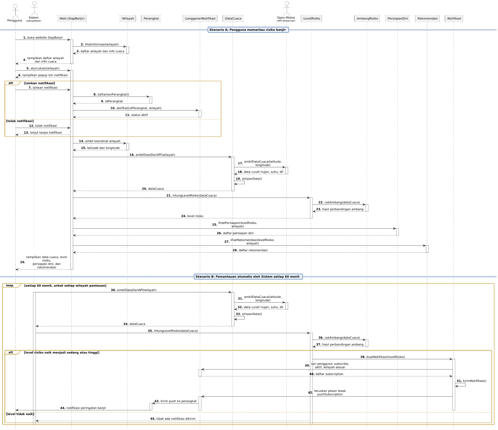

*Gambar 3 Sequence Diagram Skenario Memantau Risiko Banjir*

### Deskripsi

Sequence diagram ini menggambarkan interaksi antar objek dalam sistem SiapBanjir secara berurutan berdasarkan waktu, mulai dari aktor Pengguna mengakses website hingga sistem mengirimkan notifikasi peringatan banjir. Diagram ini melibatkan dua belas objek, yaitu Pengguna, Web (SiapBanjir), Wilayah, Perangkat, LanggananNotifikasi, DataCuaca, Open-Meteo (sebagai *external API*), LevelRisiko, AmbangRisiko, PersiapanDini, Rekomendasi, dan Notifikasi.

Alur interaksi diawali ketika Pengguna membuka website SiapBanjir, sehingga objek Web memanggil operasi *lihatInformasi(wilayah)* pada objek Wilayah untuk menampilkan daftar wilayah beserta informasi cuaca awal. Selanjutnya, Pengguna melakukan pemanggilan *aturLokasi(wilayah)* untuk memilih wilayah yang diinginkan, yang kemudian memicu tampilnya *popup* izin notifikasi.

Pada tahap ini terdapat percabangan kondisi (*alternative fragment*) yang membedakan dua skenario. Pada kondisi pertama, apabila Pengguna mengizinkan notifikasi, sistem akan mendaftarkan perangkat melalui operasi *daftarkanPerangkat()* pada objek Perangkat untuk memperoleh *idPerangkat*, kemudian mengaktifkan langganan notifikasi melalui operasi *aktifkan(idPerangkat, wilayah)* pada objek LanggananNotifikasi. Pada kondisi kedua (*else*), jika Pengguna menolak notifikasi, sistem tetap melanjutkan proses tanpa mendaftarkan perangkat.

Setelah proses perizinan notifikasi selesai, sistem mengambil koordinat wilayah dan memanggil *ambilDataDariAPI(wilayah)* pada objek DataCuaca, yang selanjutnya meneruskan permintaan ke *external API* Open-Meteo melalui operasi *ambilDataCuaca(latitude, longitude)*. Data cuaca yang diperoleh kemudian disimpan melalui operasi *simpanData()* dan dikembalikan ke objek Web. Pada implementasi, operasi ini hanya meneruskan permintaan ke Open-Meteo bila data tersimpan sudah berumur lebih dari 60 menit. Jika belum, data terbaru diambil dari basis data melalui getDataTerbaru() agar waktu respons tetap memenuhi NFR-01.

Data cuaca tersebut kemudian diproses oleh objek LevelRisiko melalui operasi *hitungLevelRisiko(dataCuaca)*, yang di dalamnya melakukan pengecekan terhadap objek AmbangRisiko melalui *cekAmbang(dataCuaca)* untuk menentukan level risiko. Hasil level risiko selanjutnya digunakan untuk memanggil *lihatPersiapan(levelRisiko, wilayah)* pada objek PersiapanDini dan *lihatRekomendasi(levelRisiko, wilayah)* pada objek Rekomendasi, sehingga seluruh informasi berupa data cuaca, level risiko, persiapan dini, dan rekomendasi dapat ditampilkan kepada Pengguna.

Tahap akhir dari sequence diagram ini merupakan *alternative fragment* kedua yang menentukan apakah notifikasi perlu dikirimkan. Jika level risiko naik menjadi sedang atau tinggi dibandingkan hasil sebelumnya, objek LevelRisiko memanggil *buatNotifikasi(levelRisiko)* pada objek Notifikasi, yang kemudian mencari daftar langganan aktif sesuai wilayah pada objek LanggananNotifikasi, dan meneruskan pesan melalui *push subscription* ke Perangkat hingga notifikasi peringatan banjir diterima oleh Pengguna. Sebaliknya, apabila kondisi tidak terpenuhi (*else*), tidak ada notifikasi yang dikirimkan kepada Pengguna.

### 1.4 Activity Diagram

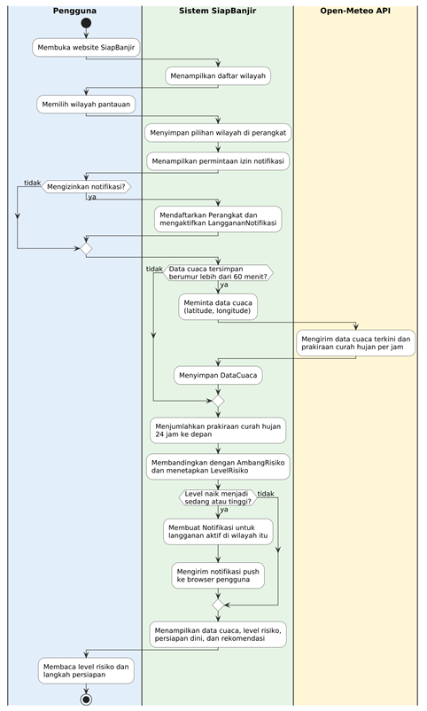

*Gambar 4 Activity Diagram Alur Pemantauan Risiko dan Notifikasi*

### Deskripsi

Activity diagram pada Gambar 4 memodelkan alur bisnis utama SiapBanjir, yaitu memantau risiko banjir di wilayah pilihan pengguna sampai notifikasi peringatan terkirim. Diagram dibagi menjadi empat swimlane, yaitu Pengguna, Sistem SiapBanjir, Open-Meteo API, dan Layanan Web Push.

Alur dimulai ketika Pengguna membuka website dan memilih wilayah. Sistem menyimpan pilihan tersebut di perangkat lalu menampilkan permintaan izin notifikasi. Jika Pengguna mengizinkan, sistem mendaftarkan Perangkat dan mengaktifkan LanggananNotifikasi. Jika tidak, alur tetap berlanjut tanpa langganan.

Berikutnya sistem memeriksa umur data cuaca yang tersimpan. Data baru diminta ke Open-Meteo API hanya jika data lama sudah berumur lebih dari 60 menit, sehingga beban ke layanan eksternal tetap kecil dan halaman lebih cepat tampil. Data yang diterima disimpan sebagai DataCuaca.

Sistem kemudian menjumlahkan prakiraan curah hujan 24 jam ke depan dan membandingkannya dengan tabel AmbangRisiko untuk menetapkan LevelRisiko sesuai Tabel 7. Jika level naik menjadi sedang atau tinggi, sistem membuat Notifikasi untuk semua langganan aktif di wilayah tersebut, lalu Layanan Web Push meneruskannya ke browser pengguna. Alur ditutup dengan tampilnya data cuaca, level risiko, persiapan dini, dan rekomendasi yang kemudian dibaca oleh Pengguna.

### 1.5 State Machine Diagram

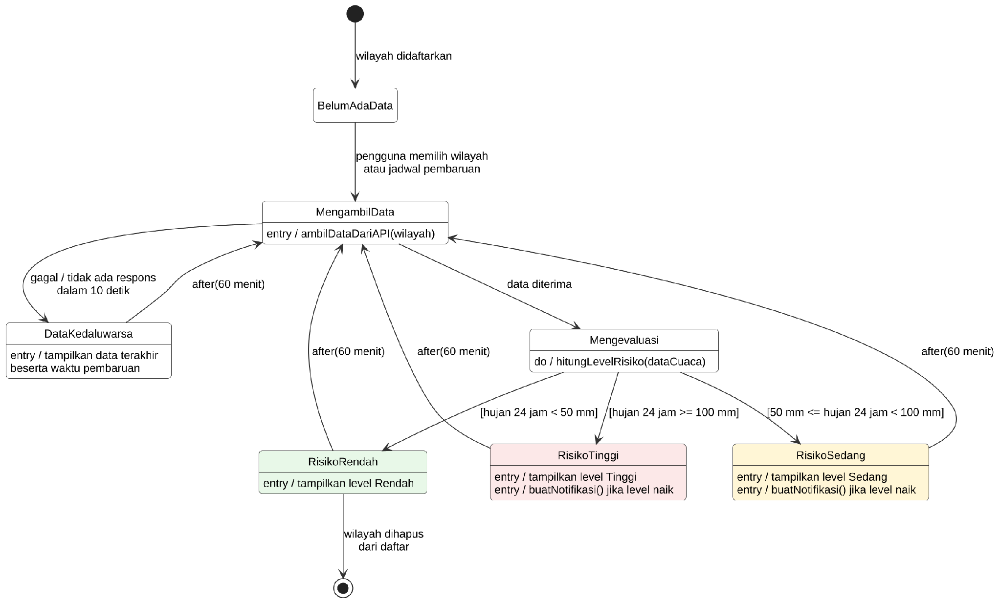

*Gambar 5 State Machine Diagram Status Risiko Sebuah Wilayah*

State machine diagram pada Gambar 5 menggambarkan siklus status risiko untuk satu wilayah pantauan. Objek yang dimodelkan adalah LevelRisiko milik sebuah Wilayah, sehingga status dan transisinya konsisten dengan class diagram dan sequence diagram.

Status awal adalah BelumAdaData, yaitu ketika wilayah sudah terdaftar tetapi belum pernah diproses. Saat pengguna memilih wilayah atau jadwal pembaruan tiba, objek masuk ke status MengambilData dan menjalankan ambilDataDariAPI(wilayah). Jika Open-Meteo gagal atau tidak merespons dalam 10 detik, objek masuk ke status DataKedaluwarsa dan sistem menampilkan data terakhir beserta waktu pembaruannya. Pengambilan data dicoba lagi pada jadwal berikutnya.

Jika data berhasil diterima, objek masuk ke status Mengevaluasi dan menjalankan hitungLevelRisiko(dataCuaca). Hasilnya menentukan salah satu dari tiga status, yaitu RisikoRendah (hujan 24 jam kurang dari 50 mm), RisikoSedang (50 sampai kurang dari 100 mm), atau RisikoTinggi (100 mm atau lebih). Ketika objek masuk ke RisikoSedang atau RisikoTinggi dari level yang lebih rendah, sistem menjalankan buatNotifikasi(). Setiap status risiko kembali ke MengambilData setelah 60 menit, dan siklus berakhir ketika wilayah dihapus dari daftar pantauan.

### 1.6 Component Diagram

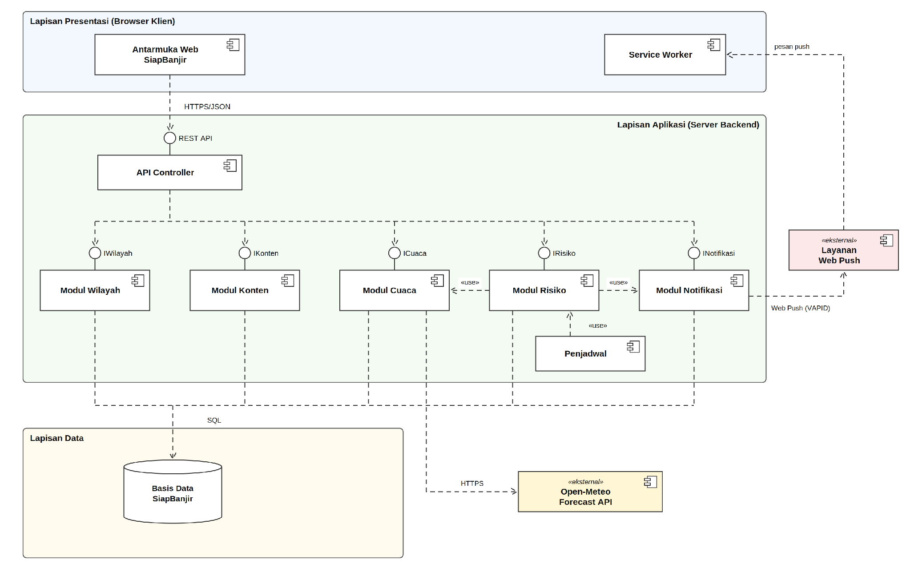

*Gambar 6 Component Diagram SiapBanjir*

Component diagram pada Gambar 6 menunjukkan modul utama SiapBanjir dan antarmuka yang menghubungkannya. Modul disusun dalam tiga lapisan. Lapisan presentasi berjalan di browser dan terdiri atas Antarmuka Web SiapBanjir serta Service Worker yang menerima pesan push. Lapisan aplikasi berjalan di server dan berisi API Controller, Penjadwal, serta lima modul bisnis. Lapisan data berisi Basis Data SiapBanjir.

Antarmuka Web hanya berkomunikasi dengan server melalui REST API yang disediakan API Controller. API Controller kemudian memakai antarmuka IWilayah, IKonten, ICuaca, IRisiko, dan INotifikasi. Modul Risiko memakai Modul Cuaca untuk memperoleh data hujan dan memakai Modul Notifikasi ketika level risiko naik. Penjadwal memanggil Modul Risiko setiap 60 menit sehingga peringatan tetap berjalan tanpa menunggu pengguna membuka website.

Hanya Modul Cuaca yang berhubungan dengan Open-Meteo, dan hanya Modul Notifikasi yang berhubungan dengan Layanan Web Push. Pembatasan ini membuat sumber data cuaca atau penyedia push dapat diganti tanpa mengubah modul lain. Pemetaan komponen ke kelas pada class diagram disajikan pada Tabel 11.

*Tabel 11 Pemetaan Komponen ke Kelas*

| **Komponen**             | **Tanggung Jawab**                                                                               | **Kelas Terkait**                            | **Antarmuka Disediakan**     |
|--------------------------|--------------------------------------------------------------------------------------------------|----------------------------------------------|------------------------------|
| Antarmuka Web SiapBanjir | Menampilkan daftar wilayah, data cuaca, level risiko, persiapan dini, rekomendasi, dan informasi | Pengguna, WebSiapBanjir                      | Tidak ada (memakai REST API) |
| Service Worker           | Menerima pesan push dan menampilkan notifikasi di perangkat                                      | Bagian klien, tidak dimodelkan sebagai kelas | Tidak ada                    |
| API Controller           | Menerima request HTTP dari klien dan meneruskannya ke modul terkait                              | WebSiapBanjir                                | REST API                     |
| Penjadwal                | Memicu pembaruan data dan perhitungan risiko setiap 60 menit                                     | Proses sistem                                | Tidak ada                    |
| Modul Wilayah            | Mengelola data wilayah beserta koordinatnya                                                      | Wilayah                                      | IWilayah                     |
| Modul Cuaca              | Mengambil, menyimpan, dan menyediakan data cuaca                                                 | DataCuaca, Open-Meteo                        | ICuaca                       |
| Modul Risiko             | Menghitung level risiko dengan tabel ambang                                                      | LevelRisiko, AmbangRisiko                    | IRisiko                      |
| Modul Konten             | Menyediakan informasi, persiapan dini, dan rekomendasi                                           | Informasi, PersiapanDini, Rekomendasi        | IKonten                      |
| Modul Notifikasi         | Mengelola perangkat, langganan, dan pengiriman push                                              | Perangkat, LanggananNotifikasi, Notifikasi   | INotifikasi                  |
| Basis Data SiapBanjir    | Menyimpan seluruh data persisten                                                                 | Semua kelas entitas                          | SQL                          |

### 1.7 Deployment Diagram

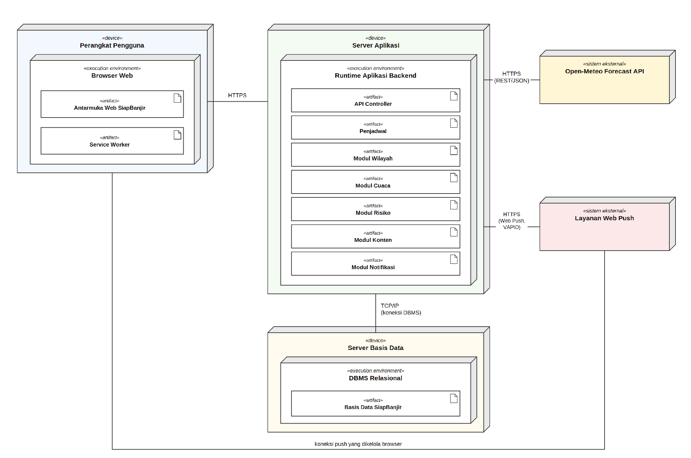

*Gambar 7 Deployment Diagram SiapBanjir*

Deployment diagram pada Gambar 7 menunjukkan tempat setiap komponen dijalankan. Antarmuka Web SiapBanjir dan Service Worker berjalan di browser pada perangkat pengguna. API Controller, Penjadwal, dan kelima modul bisnis dipasang sebagai artefak pada runtime aplikasi di Server Aplikasi. Basis Data SiapBanjir berada di Server Basis Data yang menjalankan DBMS relasional. Dengan demikian, setiap komponen pada Gambar 6 muncul sebagai artefak pada Gambar 7.

Browser berkomunikasi dengan Server Aplikasi melalui HTTPS. Server Aplikasi mengambil data dari Open-Meteo Forecast API melalui HTTPS dalam format JSON dan mengirim notifikasi ke Layanan Web Push menggunakan protokol Web Push yang diamankan dengan kunci VAPID (Thomson dkk., 2016, dan Thomson & Beverloo, 2017). Layanan Web Push adalah layanan milik penyedia browser yang meneruskan pesan ke perangkat pengguna. Untuk skala proyek semester, Server Aplikasi dan Server Basis Data boleh berada di satu mesin virtual yang sama tanpa mengubah rancangan logis ini.

### 1.8 Gaya Arsitektur

SiapBanjir memakai gaya client-server dengan backend berlapis (layered), yaitu lapisan presentasi, lapisan aplikasi, dan lapisan data. Gaya client-server dipilih karena perhitungan risiko dan pengiriman notifikasi harus tetap berjalan di server walaupun browser pengguna tertutup, sedangkan pembagian lapisan membuat aturan risiko, sumber data cuaca, dan tampilan dapat diubah secara terpisah.

---

# Kebutuhan Non-Fungsional

Kebutuhan non-fungsional disusun dengan mengacu pada kategori karakteristik kualitas produk dalam ISO/IEC 25010 (ISO/IEC, 2011). Setiap kebutuhan dibuat terukur, disertai cara pengujian, dan dihubungkan dengan elemen rancangan yang mendukungnya, seperti terlihat pada Tabel 12.

*Tabel 12 Non-Functional Requirements*

| **Kode** | **Kategori**                         | **Kebutuhan Terukur**                                                                                                                                                                                | **Cara Pengujian**                                                                                                                                                                          | **Dukungan Rancangan**                                                                                                                                                                                                |
|----------|--------------------------------------|------------------------------------------------------------------------------------------------------------------------------------------------------------------------------------------------------|---------------------------------------------------------------------------------------------------------------------------------------------------------------------------------------------|-----------------------------------------------------------------------------------------------------------------------------------------------------------------------------------------------------------------------|
| NFR-01   | Kinerja                              | 95% request halaman level risiko selesai paling lama 2 detik untuk 100 pengguna bersamaan.                                                                                                           | Uji beban dengan k6 atau JMeter memakai 100 pengguna virtual selama 5 menit, lalu periksa persentil ke-95 waktu respons.                                                                    | Data cuaca disimpan dan hanya diambil ulang dari Open-Meteo bila berumur lebih dari 60 menit (Modul Cuaca).                                                                                                           |
| NFR-02   | Keandalan                            | Jika Open-Meteo gagal atau tidak merespons dalam 10 detik, sistem tetap menampilkan data terakhir beserta waktu pembaruannya. Tidak satu pun skenario uji kegagalan boleh berakhir di halaman galat. | Simulasikan timeout dan respons HTTP 500 memakai mock server, lalu periksa tampilan halaman.                                                                                                | Status DataKedaluwarsa pada state machine dan operasi getDataTerbaru().                                                                                                                                               |
| NFR-03   | Usability                            | Minimal 8 dari 10 peserta uji dapat memilih wilayah dan menyebutkan level risikonya dalam waktu kurang dari 60 detik tanpa bantuan. Rata-rata skor SUS minimal 68.                                   | Uji usability dengan 10 peserta yang mewakili ketiga persona, lalu isi kuesioner System Usability Scale (Brooke, 1996). Angka 68 dipakai karena merupakan rata-rata skor SUS (Sauro, 2011). | Level risiko ditampilkan dengan label, warna, dan kalimat awam, tanpa proses login.                                                                                                                                   |
| NFR-04   | Keamanan                             | Seluruh komunikasi memakai HTTPS, request HTTP dialihkan ke HTTPS, dan kunci privat VAPID hanya tersimpan di server.                                                                                 | Akses alamat http:// dengan curl dan pastikan ada pengalihan 301 ke https://. Periksa berkas frontend untuk memastikan tidak ada kunci privat.                                              | Jalur HTTPS pada deployment diagram dan pengiriman push hanya dari Modul Notifikasi di server.                                                                                                                        |
| NFR-05   | Kompatibilitas                       | Semua FR berjalan di Chrome, Firefox, dan Edge versi stabil terbaru pada desktop dan Android, serta tampilan tidak terpotong pada lebar layar 360 piksel.                                            | Jalankan daftar uji fungsional di ketiga browser dan uji tampilan dengan mode perangkat pada DevTools.                                                                                      | Antarmuka responsif dan notifikasi memakai standar Push API. Di iPhone, push hanya didukung jika website ditambahkan ke Layar Utama pada iOS 16.4 ke atas (Eidson & Simmons, 2023), sehingga dicatat sebagai batasan. |
| NFR-06   | Maintainability                      | Perubahan nilai ambang dan isi rekomendasi tidak memerlukan perubahan kode dan berlaku paling lambat 60 menit kemudian. Cakupan unit test Modul Risiko minimal 80%.                                  | Ubah nilai ambang di basis data, jalankan Penjadwal, lalu periksa perubahan level. Ukur cakupan dengan alat coverage.                                                                       | Tabel AmbangRisiko, PersiapanDini, dan Rekomendasi disimpan di basis data.                                                                                                                                            |
| NFR-07   | Kinerja (ketepatan waktu peringatan) | 95% notifikasi sudah dikirim ke Layanan Web Push paling lambat 2 menit setelah perhitungan menghasilkan level yang naik.                                                                             | Masukkan data cuaca buatan yang memicu level Tinggi, lalu bandingkan waktu perhitungan dan waktu kirim pada log.                                                                            | Modul Risiko langsung memanggil Modul Notifikasi (relasi «extend» pada UC-08).                                                                                                                                        |
| NFR-08   | Privasi                              | Sistem tidak menyimpan nama, nomor telepon, maupun email. Saat pengguna menonaktifkan notifikasi, data pushSubscription perangkat tersebut dihapus.                                                  | Tinjau skema basis data, lalu nonaktifkan notifikasi dan periksa bahwa data langganan perangkat tersebut sudah terhapus.                                                                    | Tidak ada akun pengguna. Operasi nonaktifkan() dan hapusPerangkat() pada class diagram.                                                                                                                               |

---

# Traceability

Tabel 13 menelusuri lima fitur utama dari user story sampai NFR. Tabel ini memastikan setiap fitur memiliki kebutuhan, use case, dan komponen yang jelas tanpa kontradiksi antardiagram.

*Tabel 13 Traceability Fitur Utama*

| **Fitur**                      | **User Story** | **FR**              | **Use Case** | **Komponen**                                                                  | **NFR Terkait**        |
|--------------------------------|----------------|---------------------|--------------|-------------------------------------------------------------------------------|------------------------|
| Memilih wilayah pantauan       | US-01          | FR-01               | UC-01        | Antarmuka Web, API Controller, Modul Wilayah, Basis Data                      | NFR-03, NFR-05         |
| Melihat data cuaca             | US-06, US-09   | FR-02, FR-03, FR-11 | UC-03, UC-09 | Modul Cuaca, Penjadwal, Basis Data (Open-Meteo sebagai layanan eksternal)     | NFR-01, NFR-02         |
| Melihat level risiko           | US-02, US-09   | FR-04, FR-05, FR-11 | UC-04, UC-10 | Modul Risiko, Modul Cuaca, Penjadwal                                          | NFR-01, NFR-03, NFR-06 |
| Persiapan dini dan rekomendasi | US-04, US-05   | FR-06, FR-07        | UC-05, UC-06 | Modul Konten, Modul Risiko                                                    | NFR-03, NFR-06         |
| Notifikasi peringatan          | US-03, US-08   | FR-08, FR-09        | UC-02, UC-08 | Modul Notifikasi, Service Worker (Layanan Web Push sebagai layanan eksternal) | NFR-04, NFR-07, NFR-08 |

User story yang tidak masuk tabel di atas tetap dapat ditelusuri dengan cara yang sama. US-07 tentang informasi kerawanan wilayah terhubung ke FR-10, UC-07, Modul Konten, dan NFR-03.

---

# Prototype Software

Prototipe SiapBanjir disiapkan dalam dua bentuk yang saling melengkapi. Bentuk pertama adalah prototipe perangkat lunak, yaitu aplikasi web yang sudah berjalan dan mengimplementasikan kebutuhan fungsional pada Tabel 6. Bentuk kedua adalah prototipe tampilan (UI) berupa kanvas desain interaktif yang memuat seluruh layar utama beserta alur navigasinya. Tautan kedua prototipe dirangkum pada subbagian berikut.

## 1. Tautan Prototipe

1.  **Repositori kode sumber:** [https://github.com/narafathira-star/siap-banjir.git](https://github.com/narafathira-star/siap-banjir.git) (branch main). Berkas README pada repositori memuat daftar fitur, arsitektur folder, cara instalasi, variabel lingkungan, dan cara pengujian. Keputusan implementasi beserta alasannya dicatat pada [docs/DECISIONS.md](docs/DECISIONS.md).

2.  **Prototipe tampilan (UI):** [https://www.figma.com/design/bkBKZCy4FbOM77oCTr9Bu6/Siap-Banjir?t=xN2ZnQzKr2KZZVKq-1](https://www.figma.com/design/bkBKZCy4FbOM77oCTr9Bu6/Siap-Banjir?t=xN2ZnQzKr2KZZVKq-1) Kanvas ini memuat 11 layar aplikasi dan satu papan alur prototipe. Pada mode Play, tombol pada setiap layar dapat diklik untuk berpindah ke layar tujuannya.

## 2. Teknologi yang Digunakan

Prototipe dibangun sebagai aplikasi web progresif (Progressive Web App) dengan Next.js 15 (App Router) dan React 19 dalam bahasa TypeScript. Antarmuka memakai Tailwind CSS 4 dan komponen shadcn/ui, sedangkan data disimpan pada PostgreSQL 17 melalui Prisma 6. Data cuaca diambil dari Open-Meteo Weather Forecast API, notifikasi dikirim melalui Web Push dengan kunci VAPID, dan pengujian memakai Vitest untuk uji unit dan integrasi serta Playwright untuk uji end-to-end.

## 3. Pemetaan Fitur ke Prototipe

Tabel 14 memetakan setiap fitur in-scope pada Tabel 1 ke halaman prototipe yang mengimplementasikannya, ditambah satu fitur pendukung yang muncul selama implementasi.

*Tabel 14 Pemetaan Fitur In-Scope ke Halaman Prototipe*

| **Kode** | **Fitur**                                | **Halaman**            | **Implementasi pada Prototipe**                                                                                                                                                         |
|----------|------------------------------------------|------------------------|-----------------------------------------------------------------------------------------------------------------------------------------------------------------------------------------|
| F-01     | Pemilihan wilayah pantauan               | Beranda                | Pencarian desa/kelurahan, pilihan bertingkat (provinsi sampai desa/kelurahan), dan tombol Gunakan lokasi saya. Wilayah hanya dipilih dan diubah di Beranda, lalu disimpan di perangkat. |
| F-02     | Data cuaca dan prakiraan hujan per jam   | Cuaca                  | Cuaca terkini, prakiraan harian tiga hari, dan grafik per jam (curah hujan, peluang hujan, suhu) dengan tab Hari ini, Besok, dan Lusa, dilengkapi tabel nilai per jam.                  |
| F-03     | Level risiko rendah, sedang, dan tinggi  | Beranda, Risiko        | Level risiko ditampilkan dengan teks, ikon, dan warna, disertai ilustrasi ketinggian air, skor risiko 0 sampai 100, dan daftar parameter pemicu.                                        |
| F-04     | Persiapan dini dan rekomendasi tindakan  | Risiko                 | Tab Checklist Siaga yang tersimpan di perangkat dan tab Detail Mitigasi berisi langkah dari Buku Saku BNPB beserta halaman sumbernya.                                                   |
| F-05     | Informasi kebencanaan per wilayah        | Informasi              | Artikel umum kebencanaan dan riwayat kejadian banjir, masing-masing dengan tautan sumber.                                                                                               |
| F-06     | Notifikasi push browser                  | Pengaturan             | Sakelar peringatan banjir, pilihan level minimum (Sedang dan Tinggi, atau hanya Tinggi), dan tombol kirim notifikasi uji.                                                               |
| F-07     | Pembaruan data dan level risiko otomatis | Beranda, Risiko, Cuaca | Data cuaca dan level risiko diperbarui otomatis oleh penjadwal. Tombol Perbarui mengambil data terbaru dari Open-Meteo bila data sudah berumur 15 menit atau lebih.                     |
| Tambahan | Nomor darurat                            | Nomor Darurat          | Nomor 112 dan nomor darurat nasional lain, BPBD setempat, status layanan 112 per kabupaten/kota, serta konfirmasi sebelum menelepon. Semua nomor bersumber resmi.                       |

## 4. Tampilan Prototipe

Gambar 8 memperlihatkan Beranda pada tiga level risiko. Warna kartu, ilustrasi air, kalimat ajakan, dan tombol tindakan berubah mengikuti level, sedangkan nama level selalu ditulis sebagai teks sehingga level tidak hanya dibedakan lewat warna.

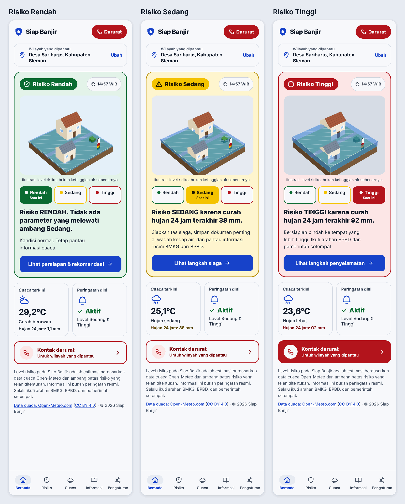

*Gambar 8 Tampilan Beranda pada Tiga Level Risiko*

Gambar 9 memperlihatkan halaman Risiko, Cuaca, Nomor Darurat, dan Pengaturan yang menjadi tujuan utama dari Beranda.

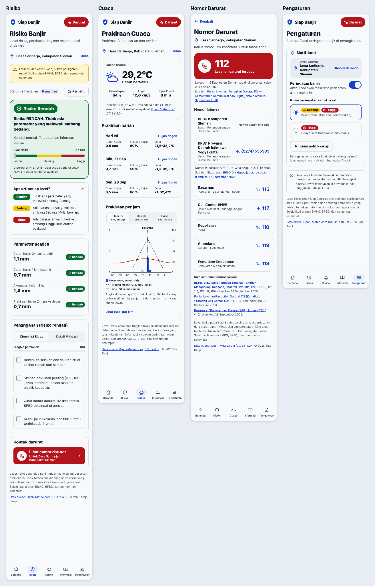

*Gambar 9 Tampilan Halaman Risiko, Cuaca, Nomor Darurat, dan Pengaturan*

## 5. Menjalankan Prototipe

Prototipe perangkat lunak dapat dijalankan secara lokal dengan langkah berikut.

1.  Pasang Node.js versi 20 atau lebih baru dan PostgreSQL 17, lalu buat basis data siapbanjir sesuai petunjuk pada README.

2.  Unduh kode sumber dengan `git clone https://github.com/akbarsyahrianto/siap-banjir.git`, lalu salin berkas `.env.example` menjadi `.env`.

3.  Jalankan `npm install`, `npm run db:migrate`, dan `npm run db:seed` untuk memasang dependensi, membuat tabel, serta mengisi data wilayah Kemendagri, ambang risiko, dan konten.

4.  Buat kunci VAPID dengan `npx web-push generate-vapid-keys` dan isi `CRON_SECRET` pada `.env` agar notifikasi push dan pembaruan terjadwal dapat berjalan.

5.  Jalankan `npm run dev`, lalu buka `http://localhost:3000` pada browser. Panduan demo simulasi risiko tinggi tersedia pada `docs/DEMO.md`.

## 6. Perbedaan Prototipe dengan Dokumen Requirements

Selama implementasi, beberapa keputusan diambil berbeda dari rancangan awal berdasarkan hasil pengujian dan sumber data yang tersedia. Setiap keputusan dicatat pada `docs/DECISIONS.md`. Tabel 15 merangkum perbedaan yang memengaruhi isi dokumen ini.

*Tabel 15 Perbedaan Prototipe dengan Dokumen Requirements*

| **Aspek**               | **Dokumen Requirements**                                               | **Prototipe**                                                                                                                                                                                                                                                                                                                          |
|-------------------------|------------------------------------------------------------------------|----------------------------------------------------------------------------------------------------------------------------------------------------------------------------------------------------------------------------------------------------------------------------------------------------------------------------------------|
| Interval pembaruan      | Setiap 60 menit (F-07, FR-11).                                         | Setiap 30 menit melalui penjadwal. Data cuaca yang tersimpan dipakai ulang paling lama 30 menit.                                                                                                                                                                                                                                       |
| Penentuan level risiko  | Akumulasi prakiraan hujan 24 jam dengan batas 50 dan 100 mm (Tabel 7). | Empat parameter dengan ambang masing-masing: curah hujan 24 jam terakhir (20 dan 50 mm), curah hujan 1 jam terakhir (10 dan 20 mm), akumulasi hujan 3 hari (60 dan 120 mm), serta prakiraan hujan 24 jam (20 dan 50 mm). Level akhir adalah level tertinggi dari keempat parameter, dan ambang tetap disimpan pada tabel AmbangRisiko. |
| Riwayat kejadian banjir | Out-of-scope (Tabel 1).                                                | Diimplementasikan pada halaman Informasi sebagai riwayat kejadian dari rilis resmi BNPB, ditambah riwayat risiko tinggi yang tercatat otomatis per kabupaten/kota.                                                                                                                                                                     |
| Nomor darurat           | Tidak dirinci sebagai fitur tersendiri.                                | Halaman Nomor Darurat dengan 112, nomor nasional lain, BPBD setempat, dan status layanan 112 dari Portal 112 Komdigi.                                                                                                                                                                                                                  |
| Cakupan wilayah         | Daftar wilayah pantauan (FR-01).                                       | Seluruh desa/kelurahan di Indonesia dengan kode Kemendagri, dipilih melalui pencarian, pilihan bertingkat, atau lokasi GPS.                                                                                                                                                                                                            |

---

# Security and Privacy

Bagian ini menjelaskan langkah pengamanan SiapBanjir pada tiga aspek keamanan informasi, yaitu ketersediaan (availability), kerahasiaan (confidentiality), dan integritas (integrity). Setiap aspek memuat rancangan atau konfigurasi yang dipasang, kemudian pengujian yang berisi langkah, perintah yang dijalankan, fungsi perintah tersebut, dan tangkapan layar hasilnya.

Pengujian dijalankan pada lingkungan lokal Docker Compose di Windows melalui PowerShell. Lingkungan ini terdiri atas lima layanan, yaitu app (aplikasi Next.js), db (PostgreSQL 17), cron (penjadwal pembaruan data cuaca), backup (pencadangan basis data), dan caddy (reverse proxy HTTPS). Di PowerShell, curl merupakan alias dari Invoke-WebRequest, sehingga pengujian HTTP memanggil curl.exe secara lengkap.

## 1. Security Availability

Availability berarti layanan tetap dapat diakses ketika salah satu komponen bermasalah dan data dapat dipulihkan bila terjadi kerusakan. Aspek ini penting bagi SiapBanjir karena peringatan banjir paling dibutuhkan justru saat permintaan sedang tinggi atau layanan pendukung terganggu.

**A. Rancangan dan Konfigurasi (Bukti Desain)**

**a. Konfigurasi layanan basis data**

Layanan db didefinisikan pada berkas `docker-compose.yml` seperti pada Gambar 10. Pengaturan yang mendukung availability adalah sebagai berikut.

- `restart: unless-stopped` menyalakan ulang container secara otomatis bila prosesnya berhenti karena galat atau setelah Docker dinyalakan ulang, kecuali container sengaja dihentikan.

- healthcheck menjalankan `pg_isready` setiap 5 detik dengan batas waktu 5 detik dan maksimal 10 kali percobaan. Container baru berstatus healthy setelah PostgreSQL siap menerima koneksi.

- Volume `pgdata` menyimpan data di luar container sehingga data tidak hilang ketika container dibuat ulang.

- `mem_limit: 512m` membatasi pemakaian memori agar basis data tidak menghabiskan sumber daya komputer.

- Port basis data hanya diikat ke 127.0.0.1, sehingga basis data hanya dapat diakses dari komputer server, tidak dari jaringan.

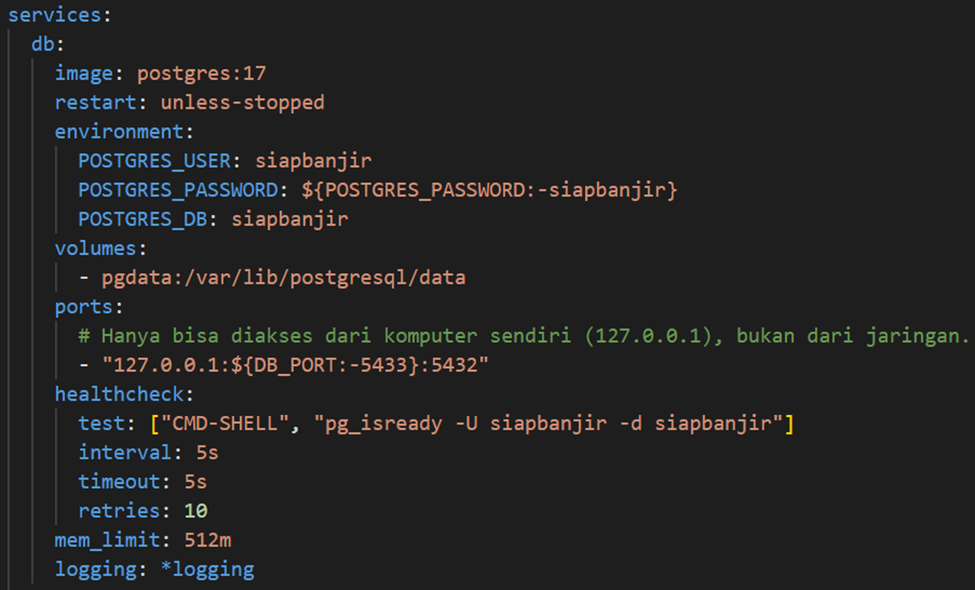

*Gambar 10 Konfigurasi Layanan db pada docker-compose.yml*

**b. Konfigurasi layanan aplikasi**

Gambar 11 memperlihatkan konfigurasi layanan app. Pengaturan yang mendukung availability adalah sebagai berikut.

- `depends_on` dengan `condition: service_healthy` membuat aplikasi baru dijalankan setelah basis data berstatus healthy, sehingga aplikasi tidak gagal karena basis data belum siap.

- command menjalankan `npx prisma migrate deploy` sebelum `npm start`, sehingga skema basis data selalu sesuai dengan versi aplikasi saat server dinyalakan.

- `restart: unless-stopped` dan healthcheck berfungsi seperti pada layanan basis data.

- `env_file: .env` memberikan konfigurasi rahasia saat container berjalan, bukan ditanam di dalam image.

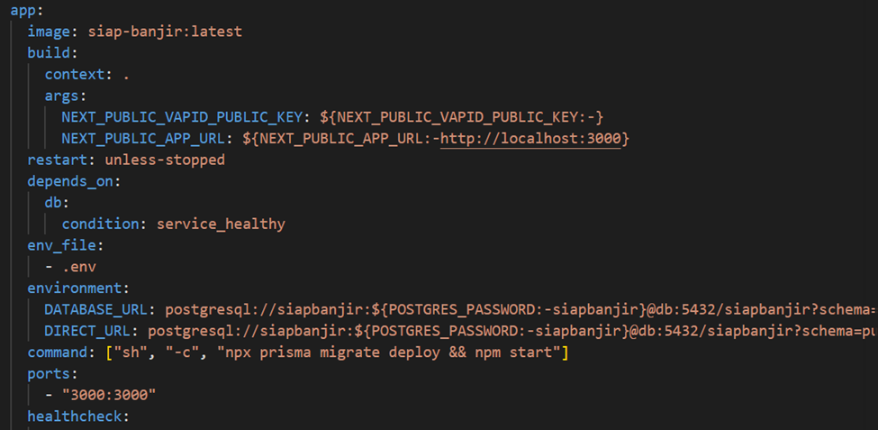

*Gambar 11 Konfigurasi Layanan app pada docker-compose.yml*

**c. Endpoint pemeriksaan kesehatan**

Endpoint `/api/health` berada pada berkas `src/app/api/health/route.ts` (Gambar 12). Endpoint ini mengembalikan `{"status":"ok"}` ketika aplikasi dan basis data berfungsi, serta HTTP 503 dengan `{"status":"error"}` ketika basis data tidak dapat dihubungi. Healthcheck container app memakai respons ini, sehingga status container berubah menjadi unhealthy saat basis data mati (Uji 2).

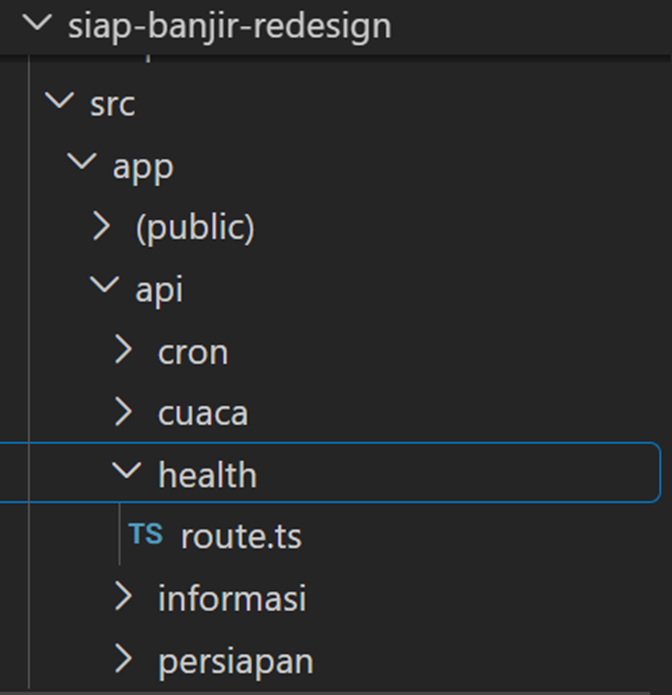

*Gambar 12 Lokasi Endpoint /api/health*

**d. Pembatasan laju permintaan (rate limiting)**

Modul `src/lib/rate-limit.ts` (Gambar 13) membatasi jumlah permintaan dari satu klien dalam rentang waktu tertentu. Permintaan yang melebihi batas ditolak dengan HTTP 429 Too Many Requests disertai header Retry-After. Pembatasan ini mencegah satu klien membebani server dengan permintaan beruntun (Uji 4).

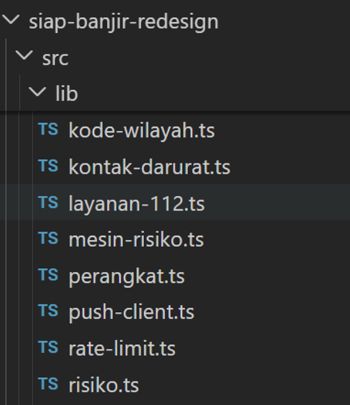

*Gambar 13 Lokasi Modul Rate Limiting*

**e. Data cuaca cadangan**

Fungsi `lihatDataCuaca` pada berkas `src/server/services/weather.service.ts` (Gambar 14) menentukan sumber data cuaca dalam tiga kondisi. Jika data tersimpan masih segar, sistem memakai data tersebut tanpa memanggil Open-Meteo. Jika pemakaian 24 jam sudah mencapai batas kuota, sistem memakai data tersimpan terakhir dengan penanda hemat-kuota. Jika pemanggilan Open-Meteo gagal, galat dicatat ke log dan sistem tetap mengembalikan data terakhir dengan penanda cadangan. Mekanisme ini mendukung NFR-02, yaitu halaman tetap menampilkan data terakhir ketika layanan cuaca terganggu.

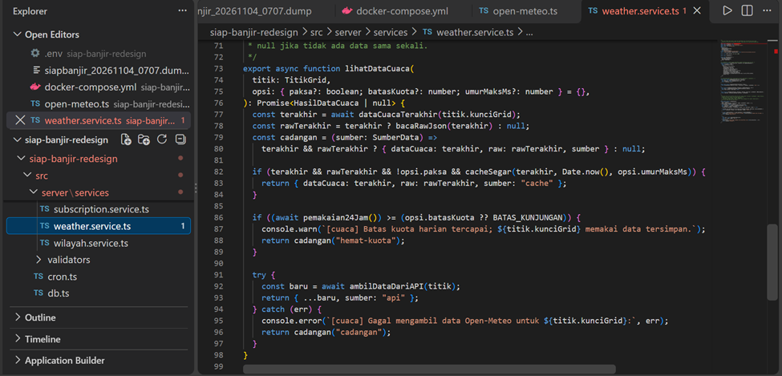

*Gambar 14 Fungsi lihatDataCuaca dengan Data Cadangan*

**f. Pemeriksaan layanan yang berjalan**

1. Tampilkan status seluruh container.

   ```powershell
   docker compose ps
   ```

   **Fungsi:** Menampilkan daftar container proyek beserta image, waktu dibuat, status, hasil healthcheck, dan pemetaan port.

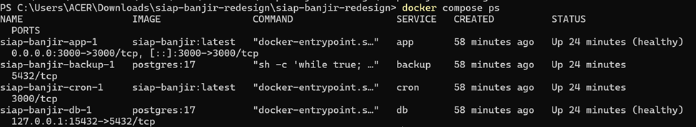

*Gambar 15 Status Container Hasil docker compose ps*

2. Periksa endpoint kesehatan aplikasi.

   ```powershell
   curl.exe http://localhost:3000/api/health
   ```

   **Fungsi:** Mengirim permintaan HTTP GET ke endpoint `/api/health` dan menampilkan isi responsnya.

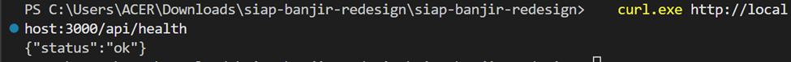

*Gambar 16 Respons Endpoint /api/health*

3. Buka `http://localhost:3000` di browser untuk memastikan halaman aplikasi tampil.

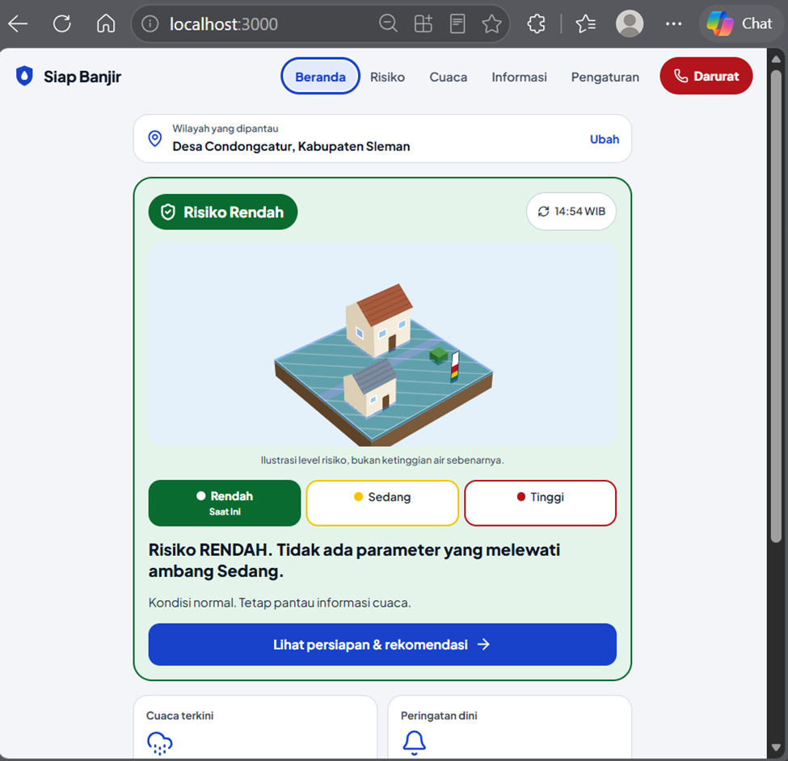

*Gambar 17 Aplikasi SiapBanjir Berjalan di http://localhost:3000*

**Hasil:** Keempat container berjalan, dengan app dan db berstatus healthy (Gambar 15). Endpoint kesehatan merespons `{"status":"ok"}` (Gambar 16) dan Beranda tampil normal (Gambar 17).

**g. Pencadangan basis data otomatis**

Layanan backup memakai image `postgres:17` dan menjalankan perulangan `sh -c 'while true; …'` yang membuat cadangan basis data secara berkala. Berkas cadangan disimpan di folder backups dengan nama yang memuat tanggal dan jam pembuatan, misalnya `siapbanjir_20261104_0707.dump` (Gambar 18). Folder ini berada di luar container sehingga cadangan tetap ada walaupun container dihapus. Kemampuan memulihkan cadangan dibuktikan pada Uji 5.

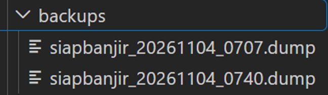

*Gambar 18 Berkas Cadangan di Folder backups*

**B. Pengujian**

**Uji 1: Crash recovery**

Uji ini memastikan aplikasi yang mati mendadak dapat berjalan kembali tanpa memengaruhi layanan lain.

1. Catat jumlah restart awal container aplikasi.

   ```powershell
   docker inspect --format "{{.RestartCount}}" siap-banjir-app-1
   ```

   **Fungsi:** Membaca atribut RestartCount, yaitu berapa kali Docker sudah menyalakan ulang container secara otomatis. Nilai awal 0 menjadi pembanding.

2. Matikan container aplikasi secara paksa untuk menyimulasikan crash.

   ```powershell
   docker compose kill app
   ```

   **Fungsi:** Mengirim sinyal SIGKILL sehingga proses aplikasi langsung berhenti tanpa tahapan penutupan normal, seperti saat server crash.

3. Periksa status container.

   ```powershell
   docker compose ps
   ```

   **Fungsi:** Memastikan container app sudah berhenti, sedangkan db, cron, dan backup tetap berjalan.

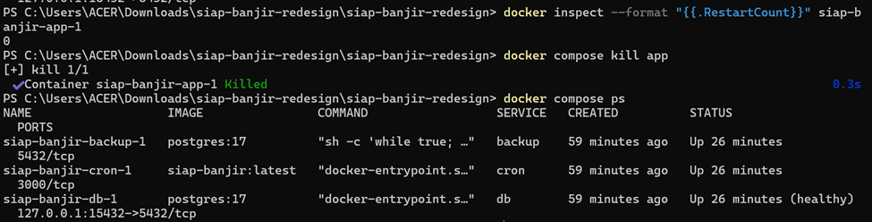

*Gambar 19 Simulasi Crash dengan docker compose kill*

4. Jalankan kembali container aplikasi.

   ```powershell
   docker compose start app
   ```

   **Fungsi:** Menyalakan kembali container app yang sama tanpa membuat container baru.

5. Periksa status container dan endpoint kesehatan.

   ```powershell
   docker compose ps
   curl.exe http://localhost:3000/api/health
   ```

   **Fungsi:** Memastikan container app kembali berstatus healthy dan endpoint kesehatan kembali merespons.

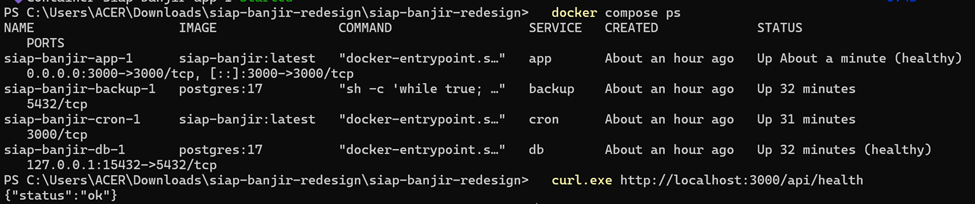

*Gambar 20 Aplikasi Kembali Healthy setelah Dijalankan Ulang*

**Hasil:** Gambar 19 menunjukkan bahwa matinya app tidak menghentikan layanan lain. Setelah dijalankan kembali, app sudah berstatus healthy sekitar satu menit kemudian dan endpoint kesehatan merespons `{"status":"ok"}` (Gambar 20). Docker menganggap container yang dihentikan dengan perintah kill sebagai container yang dihentikan secara manual, sehingga kebijakan unless-stopped tidak menyalakannya ulang secara otomatis. Karena itu, pada uji ini container dinyalakan dengan perintah start. Restart otomatis berlaku ketika proses aplikasi berhenti sendiri karena galat.

**Uji 2: Database mati**

Uji ini memastikan aplikasi mendeteksi basis data yang tidak tersedia dan melaporkannya dengan jelas.

1. Hentikan layanan basis data.

   ```powershell
   docker compose stop db
   ```

   **Fungsi:** Menghentikan container db secara normal untuk menyimulasikan basis data yang tidak tersedia.

2. Periksa endpoint kesehatan beserta header responsnya.

   ```powershell
   curl.exe -i http://localhost:3000/api/health
   ```

   **Fungsi:** Opsi -i menampilkan baris status dan header HTTP di samping isi respons.

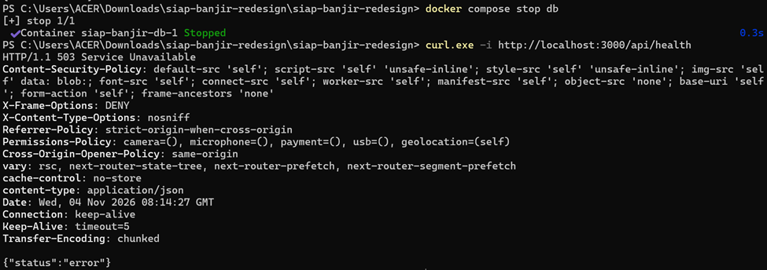

*Gambar 21 Respons /api/health saat Basis Data Dihentikan*

3. Periksa status container.

   ```powershell
   docker compose ps
   ```

   **Fungsi:** Melihat penilaian healthcheck terhadap container app ketika basis data mati.

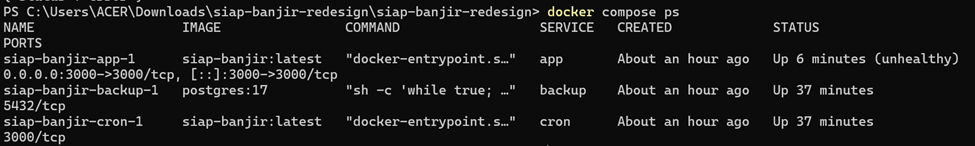

*Gambar 22 Container app Berstatus Unhealthy saat Basis Data Mati*

**Hasil:** Endpoint kesehatan merespons HTTP 503 Service Unavailable dengan `{"status":"error"}` (Gambar 21), tidak menggantung atau menampilkan halaman galat. Header `cache-control: no-store` mencegah status ini tersimpan di cache. Container app berubah menjadi unhealthy, sedangkan db tidak lagi tercantum karena sudah dihentikan (Gambar 22). Status ini dapat dipakai sistem pemantauan untuk memberi peringatan kepada pengelola.

**Uji 3: Pemulihan**

Uji ini memastikan aplikasi tersambung kembali secara otomatis setelah basis data aktif lagi.

1. Nyalakan kembali layanan basis data.

   ```powershell
   docker compose start db
   ```

   **Fungsi:** Menyalakan kembali container db yang sama beserta volume datanya.

2. Periksa endpoint kesehatan dan status container.

   ```powershell
   curl.exe http://localhost:3000/api/health
   docker compose ps
   ```

   **Fungsi:** Memastikan aplikasi kembali terhubung ke basis data dan kedua container kembali healthy.

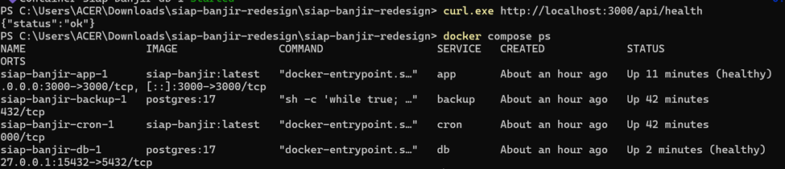

*Gambar 23 Aplikasi Pulih setelah Basis Data Aktif Kembali*

**Hasil:** Endpoint kesehatan kembali merespons `{"status":"ok"}`, dan app serta db kembali healthy (Gambar 23). Container app sudah berjalan selama 11 menit, artinya aplikasi tidak dinyalakan ulang dan tersambung kembali ke basis data dengan sendirinya.

**Uji 4: Rate limit**

Uji ini memastikan satu klien tidak dapat membanjiri server dengan permintaan beruntun.

1. Kirim 70 permintaan berturut-turut ke API cuaca.

   ```powershell
   1..70 | ForEach-Object { "{0,2}: {1}" -f $\_, (curl.exe -s -o NUL -w "%{http_code}" "http://localhost:3000/api/cuaca?wilayah=34.04.12.2001") }
   ```

   **Fungsi:** Perulangan PowerShell dari 1 sampai 70. Pada setiap putaran, curl.exe berjalan tanpa menampilkan progres (-s), membuang isi respons (-o NUL), dan hanya mencetak kode status HTTP (-w "%{http_code}"). Kode status dicetak bersama nomor urut permintaan.

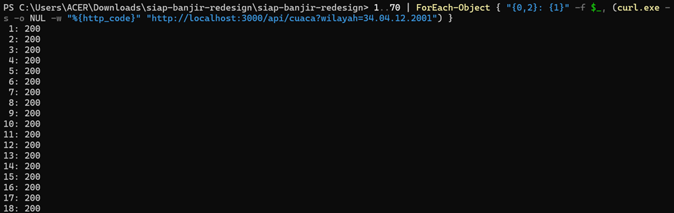

*Gambar 24 Permintaan Awal Dilayani dengan Status 200*

2. Kirim satu permintaan lagi dan tampilkan header responsnya.

   ```powershell
   curl.exe -i "http://localhost:3000/api/cuaca?wilayah=34.04.12.2001"
   ```

   **Fungsi:** Memeriksa kode status dan header respons setelah batas permintaan terlampaui.

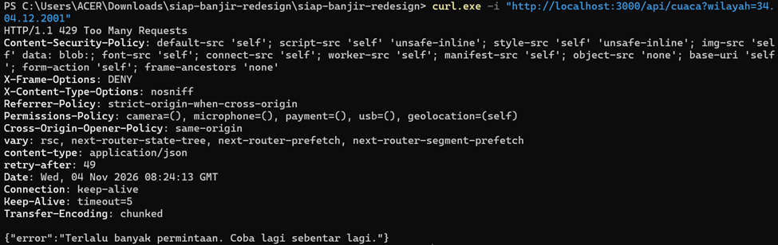

*Gambar 25 Respons 429 Too Many Requests*

**Hasil:** Permintaan awal dilayani dengan status 200 (Gambar 24). Setelah batas terlampaui, server menolak permintaan dengan HTTP 429 Too Many Requests, pesan Terlalu banyak permintaan. Coba lagi sebentar lagi., dan header `Retry-After: 49` yang memberi tahu klien untuk menunggu 49 detik sebelum mencoba lagi (Gambar 25).

**Uji 5: Restore backup**

Uji ini membuktikan bahwa berkas cadangan dapat dipulihkan dan isinya lengkap.

1. Buat cadangan baru.

   ```powershell
   docker compose exec backup sh -c 'pg_dump -h db -U siapbanjir -Fc siapbanjir > /backups/uji_restore.dump'
   ```

   **Fungsi:** Menjalankan pg_dump di dalam container backup untuk mencadangkan basis data siapbanjir dari host db. Opsi -Fc menghasilkan format custom yang terkompresi dan dapat dipulihkan dengan pg_restore. Hasilnya ditulis ke `/backups/uji_restore.dump`.

2. Lihat berkas di folder cadangan.

   ```powershell
   Get-ChildItem backups | Select-Object Name, Length
   ```

   **Fungsi:** Menampilkan nama dan ukuran (byte) setiap berkas di folder backups untuk memastikan berkas cadangan terbentuk.

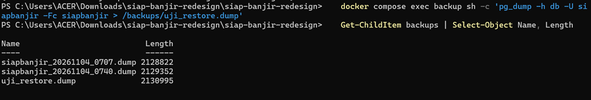

*Gambar 26 Pembuatan Berkas Cadangan uji_restore.dump*

3. Salin berkas cadangan ke container basis data.

   ```powershell
   docker compose cp backups/uji_restore.dump db:/tmp/uji_restore.dump
   ```

   **Fungsi:** Menyalin berkas cadangan dari folder proyek ke folder /tmp di dalam container db.

4. Buat basis data uji.

   ```powershell
   docker compose exec db psql -U siapbanjir -d postgres -c "CREATE DATABASE siapbanjir_restore;"
   ```

   **Fungsi:** Membuat basis data kosong `siapbanjir_restore` sebagai tujuan pemulihan, sehingga basis data utama tidak tersentuh.

5. Pulihkan cadangan ke basis data uji.

   ```powershell
   docker compose exec db pg_restore -U siapbanjir -d siapbanjir_restore /tmp/uji_restore.dump
   ```

   **Fungsi:** Membangun ulang seluruh skema dan data dari berkas cadangan ke basis data `siapbanjir_restore`.

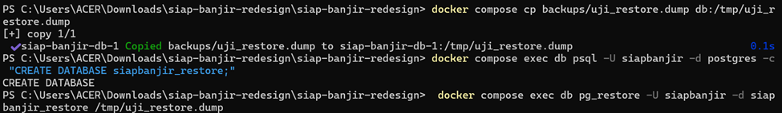

*Gambar 27 Pemulihan Cadangan ke Basis Data Uji*

6. Bandingkan jumlah data pada kedua basis data.

   ```powershell
   docker compose exec db psql -U siapbanjir -d siapbanjir -c "SELECT count(*) FROM wilayah;"
   docker compose exec db psql -U siapbanjir -d siapbanjir_restore -c "SELECT count(*) FROM wilayah;"
   ```

   **Fungsi:** Menghitung jumlah baris tabel wilayah pada basis data utama dan pada basis data hasil pemulihan.

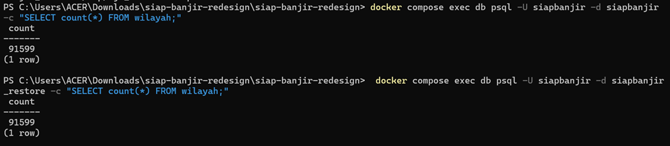

*Gambar 28 Perbandingan Jumlah Data Basis Data Utama dan Hasil Pemulihan*

7. Hapus basis data uji.

   ```powershell
   docker compose exec db psql -U siapbanjir -d postgres -c "DROP DATABASE siapbanjir_restore;"
   ```

   **Fungsi:** Menghapus basis data `siapbanjir_restore` setelah pengujian selesai.

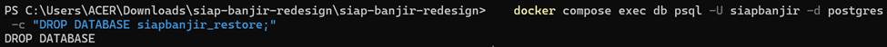

*Gambar 29 Penghapusan Basis Data Uji*

**Hasil:** Berkas cadangan berukuran 2.130.995 byte terbentuk di folder backups (Gambar 26) dan berhasil dipulihkan ke basis data terpisah (Gambar 27). Tabel wilayah pada kedua basis data sama-sama berisi 91.599 baris (Gambar 28), sehingga cadangan dapat dipulihkan dengan data yang utuh.

## 2. Security Confidentiality

Confidentiality berarti data hanya dapat dibaca oleh pihak yang berwenang. SiapBanjir tidak menyimpan nama, nomor telepon, maupun email pengguna (NFR-08). Data paling sensitif adalah data langganan notifikasi (push subscription), karena berisi alamat endpoint dan kunci perangkat yang dapat dipakai untuk mengirim notifikasi ke perangkat tersebut.

**A. Rancangan dan Konfigurasi (Bukti Desain)**

Pengamanan kerahasiaan yang dipasang adalah sebagai berikut.

- Komunikasi melalui HTTPS. Caddy berperan sebagai reverse proxy yang menerima koneksi HTTPS di port 8443 lalu meneruskannya ke aplikasi. Untuk pengujian lokal, sertifikat diterbitkan oleh CA lokal milik Caddy.

- Port aplikasi dan basis data hanya diikat ke 127.0.0.1, sehingga keduanya tidak dapat diakses langsung dari jaringan.

- Data push subscription dienkripsi dengan AES-256-GCM sebelum disimpan ke basis data.

- Container aplikasi berjalan sebagai pengguna biasa (node), bukan root.

- Berkas `.env` yang berisi rahasia tidak ikut dimasukkan ke image Docker.

- Password basis data tidak lagi memakai nilai bawaan.

- Endpoint penjadwal `/api/cron/update-weather` hanya dapat dipanggil dengan secret.

- Setiap respons membawa header keamanan, antara lain `Content-Security-Policy`, `X-Frame-Options: DENY`, `X-Content-Type-Options: nosniff`, `Referrer-Policy`, dan `Permissions-Policy` (terlihat pada Gambar 21).

**Menjalankan layanan dengan reverse proxy HTTPS**

1. Periksa bahwa folder `tests/unit` tidak berisi berkas Caddyfile.

   ```powershell
   Get-ChildItem .\tests\unit\Caddyfile -ErrorAction SilentlyContinue
   ```

   **Fungsi:** Mencari berkas Caddyfile di folder `tests/unit`. Opsi -ErrorAction SilentlyContinue menyembunyikan pesan galat jika berkas tidak ditemukan, sehingga keluaran kosong berarti berkas tersebut tidak ada.

2. Jalankan seluruh layanan.

   ```powershell
   docker compose --profile cron --profile backup up -d
   ```

   **Fungsi:** Membuat dan menjalankan semua layanan di latar belakang (-d). Opsi --profile mengaktifkan layanan cron dan backup yang hanya berjalan bila profilnya disebut. Layanan caddy ikut dijalankan.

3. Periksa status container.

   ```powershell
   docker compose ps
   ```

   **Fungsi:** Memastikan caddy berjalan dengan pemetaan 127.0.0.1:8443-\>443/tcp dan port app hanya terbuka di `127.0.0.1:3000`.

4. Akses endpoint kesehatan melalui HTTPS.

   ```powershell
   curl.exe -k https://localhost:8443/api/health
   ```

   **Fungsi:** Mengirim permintaan melalui Caddy dengan HTTPS. Opsi -k melewati verifikasi sertifikat karena CA lokal Caddy belum dipercaya oleh Windows.

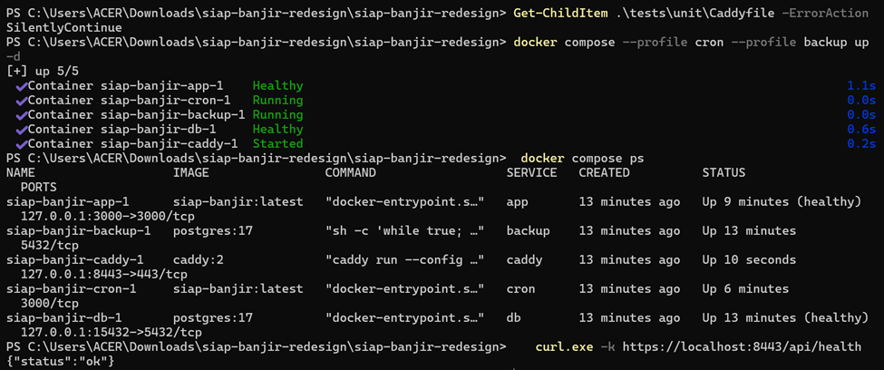

*Gambar 30 Menjalankan Layanan dengan Reverse Proxy HTTPS*

**Hasil:** Kelima layanan berjalan dan endpoint kesehatan merespons `{"status":"ok"}` melalui HTTPS (Gambar 30).

**B. Pengujian**

**Uji C1: Unit test enkripsi**

Uji ini memastikan fungsi enkripsi dan dekripsi data langganan bekerja benar dan gagal secara aman.

1. Jalankan unit test enkripsi di dalam container aplikasi.

   ```powershell
   docker compose exec app npx vitest run tests/unit/enkripsi.test.ts
   ```

   **Fungsi:** Menjalankan berkas tes `enkripsi.test.ts` dengan Vitest di dalam container app.

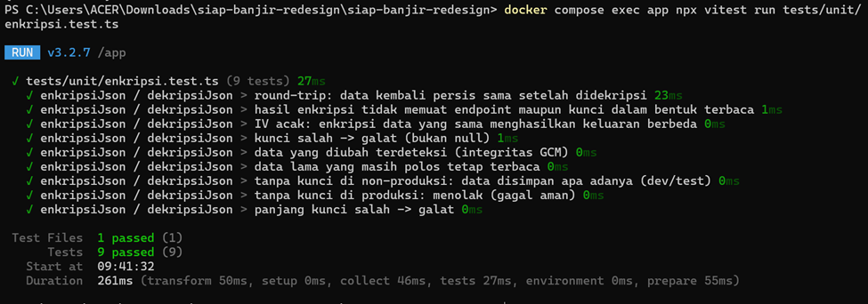

*Gambar 31 Hasil Unit Test Enkripsi*

**Hasil:** Kesembilan tes lulus (Gambar 31). Tes tersebut membuktikan bahwa data kembali persis sama setelah didekripsi, hasil enkripsi tidak memuat endpoint maupun kunci dalam bentuk terbaca, dan IV acak membuat data yang sama menghasilkan keluaran berbeda. Kunci yang salah dan panjang kunci yang salah menghasilkan galat, sedangkan data yang diubah terdeteksi oleh pemeriksaan integritas GCM. Data lama yang masih polos tetap terbaca. Tanpa kunci, data disimpan apa adanya di lingkungan pengembangan dan pengujian, tetapi di lingkungan produksi sistem menolak memproses data (gagal aman).

**Uji C2: HTTPS aktif**

Uji ini memastikan koneksi ke aplikasi melalui port 8443 menggunakan TLS.

1. Kirim permintaan HTTPS dengan keluaran rinci, lalu saring baris yang relevan.

   ```powershell
   curl.exe -k -v https://localhost:8443/api/health 2>&1 | Select-String "SSL connection|TLSv|HTTP/|status"
   ```

   **Fungsi:** Opsi -v menampilkan detail koneksi, termasuk proses jabat tangan (handshake) TLS. 2\>&1 menggabungkan keluaran detail tersebut ke keluaran utama, lalu Select-String menyaring baris yang memuat kata kunci terkait TLS, versi HTTP, dan status.

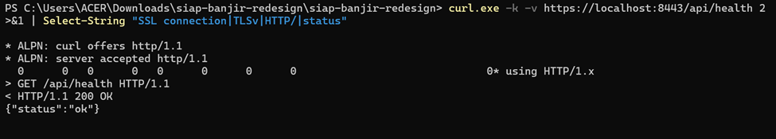

*Gambar 32 Verifikasi Koneksi HTTPS dengan curl*

**Hasil:** Klien dan server menyepakati protokol HTTP/1.1 melalui ALPN, yaitu ekstensi yang dinegosiasikan di dalam jabat tangan TLS. Permintaan GET `/api/health` kemudian dijawab HTTP/1.1 200 OK (Gambar 32). Hal ini menunjukkan komunikasi melalui port 8443 berjalan di atas TLS.

**Uji C3: Sertifikat di browser**

Uji ini memastikan browser menerima sertifikat HTTPS setelah CA lokal Caddy dipercaya.

1. Buka `https://localhost:8443` di browser. Browser menampilkan peringatan Your connection isn't private dengan kode `NET::ERR_CERT_AUTHORITY_INVALID`, karena sertifikat diterbitkan oleh CA lokal Caddy yang belum dipercaya Windows (Gambar 33).

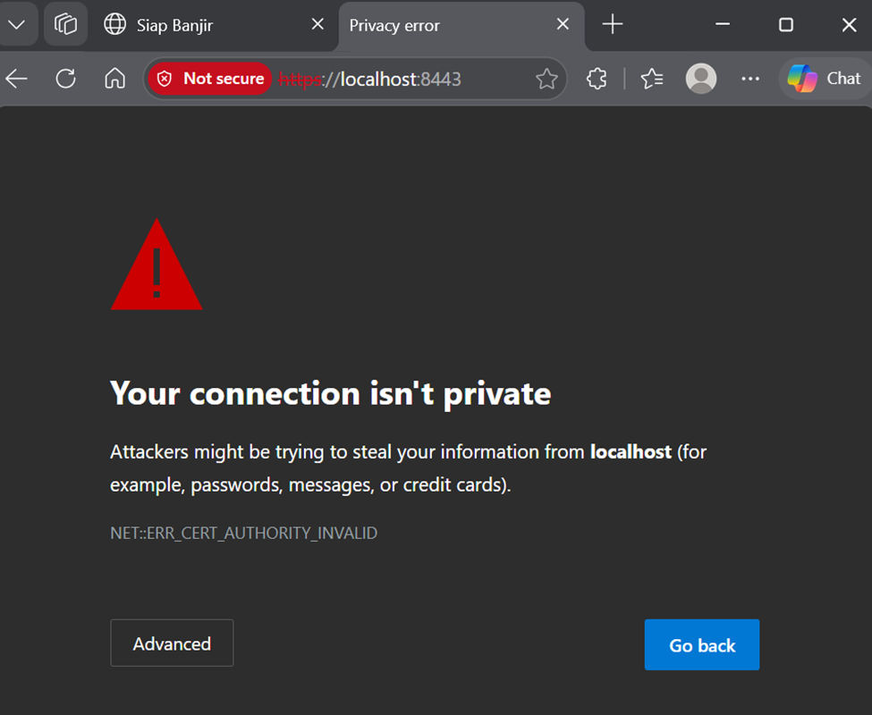

*Gambar 33 Peringatan Sertifikat sebelum CA Lokal Dipercaya*

2. Salin sertifikat root CA lokal dari container Caddy.

   ```powershell
   docker compose cp caddy:/data/caddy/pki/authorities/local/root.crt .\caddy-root.crt
   ```

   **Fungsi:** Menyalin sertifikat root yang dibuat Caddy dari dalam container ke folder proyek dengan nama `caddy-root.crt`.

3. Pasang sertifikat ke daftar CA tepercaya Windows.

   ```powershell
   certutil -addstore -user Root .\caddy-root.crt
   ```

   **Fungsi:** Menambahkan sertifikat ke penyimpanan Trusted Root Certification Authorities milik pengguna yang sedang login (-user). Setelah itu, browser memercayai sertifikat yang diterbitkan CA tersebut.

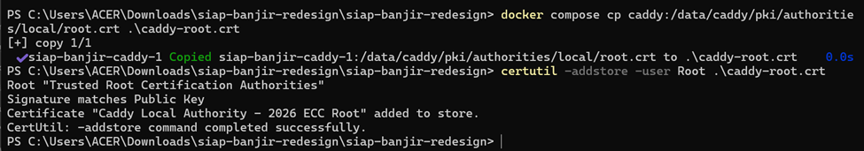

*Gambar 34 Pemasangan Sertifikat Root CA Caddy*

4. Tekan Yes pada dialog konfirmasi Windows, tutup browser, lalu buka kembali `https://localhost:8443`.

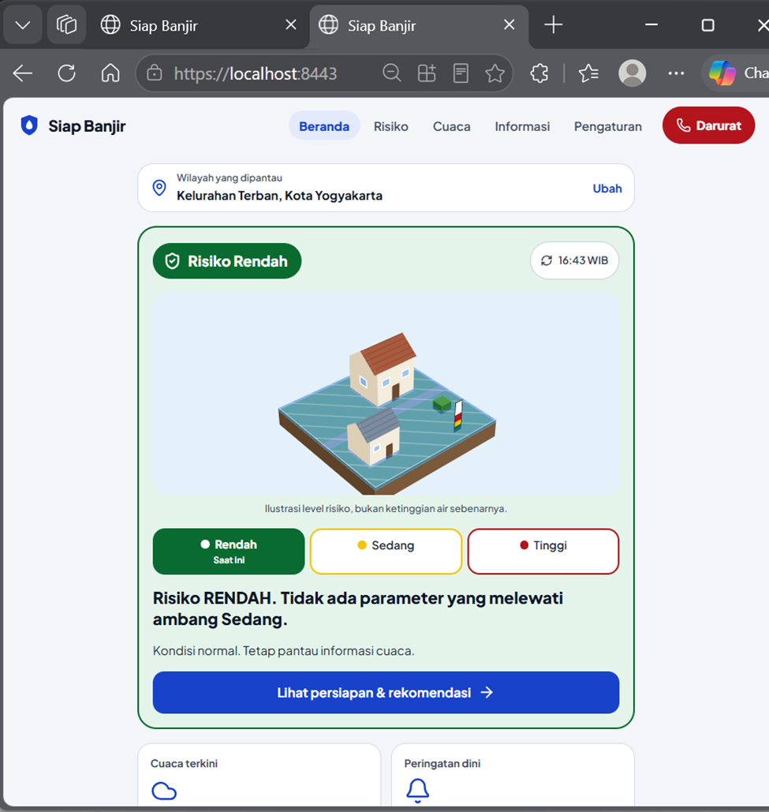

*Gambar 35 Halaman Terbuka melalui HTTPS tanpa Peringatan*

**Hasil:** Setelah sertifikat root dipasang, halaman terbuka tanpa peringatan dan bilah alamat menampilkan ikon gembok (Gambar 35). Sertifikat ini hanya untuk pengujian lokal dan dihapus setelah laporan selesai dengan perintah berikut.

   ```powershell
   certutil -delstore -user Root "Caddy Local Authority - 2026 ECC Root"
   ```

   **Fungsi:** Menghapus sertifikat root Caddy dari daftar CA tepercaya pengguna.

**Uji C4: Container bukan root**

Uji ini memastikan aplikasi tidak berjalan dengan hak administrator di dalam container.

1. Tampilkan nama pengguna di dalam container aplikasi.

   ```powershell
   docker compose exec app whoami
   ```

   **Fungsi:** Menampilkan nama pengguna yang menjalankan perintah di dalam container app.

2. Tampilkan identitas lengkap pengguna tersebut.

   ```powershell
   docker compose exec app id
   ```

   **Fungsi:** Menampilkan UID, GID, dan grup pengguna tersebut.

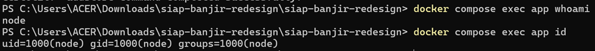

*Gambar 36 Pengguna yang Menjalankan Container app*

**Hasil:** Container berjalan sebagai pengguna node dengan `uid=1000`, bukan root yang memiliki uid 0 (Gambar 36). Jika aplikasi berhasil dibobol, penyerang tidak langsung memperoleh hak root di dalam container.

**Uji C5: Password lama ditolak**

Uji ini memastikan password bawaan basis data sudah tidak berlaku.

1. Coba masuk ke basis data dengan password bawaan lama.

   ```powershell
   docker compose exec -e PGPASSWORD=siapbanjir backup psql -h db -U siapbanjir -d siapbanjir -c "SELECT 1"
   ```

   **Fungsi:** Menjalankan psql dari container backup dengan password lama siapbanjir yang dikirim melalui variabel lingkungan PGPASSWORD (opsi -e).

2. Coba masuk dengan password yang dikonfigurasi pada container backup.

   ```powershell
   docker compose exec backup psql -h db -U siapbanjir -d siapbanjir -c "SELECT 1"
   ```

   **Fungsi:** Menjalankan kueri yang sama memakai password yang sudah tersimpan di konfigurasi container backup.

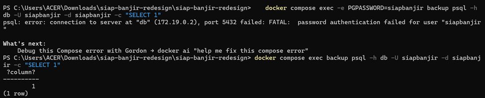

*Gambar 37 Password Lama Ditolak oleh Basis Data*

**Hasil:** Password lama ditolak dengan pesan password authentication failed, sedangkan password yang benar menghasilkan satu baris data (Gambar 37).

**Uji C6: `.env` tidak masuk ke image**

Uji ini memastikan berkas rahasia tidak ikut tersimpan di dalam image Docker.

1. Cari berkas `.env` di dalam container aplikasi.

   ```powershell
   docker compose exec app ls -la /app/.env
   ```

   **Fungsi:** Menampilkan berkas `.env` di folder aplikasi /app jika berkas tersebut ada di dalam container.

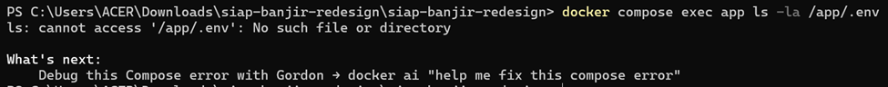

*Gambar 38 Berkas .env Tidak Ditemukan di dalam Container*

**Hasil:** Berkas `.env` tidak ditemukan (No such file or directory) (Gambar 38). Rahasia seperti kunci privat VAPID, kunci enkripsi, dan password basis data hanya diberikan saat container berjalan melalui env_file, sehingga image dapat dibagikan tanpa membocorkan rahasia.

**Uji C7: Endpoint cron menolak tanpa secret**

Uji ini memastikan endpoint penjadwal tidak dapat dipanggil oleh pihak luar.

1. Panggil endpoint penjadwal tanpa secret.

   ```powershell
   curl.exe -i http://localhost:3000/api/cron/update-weather
   ```

   **Fungsi:** Memanggil endpoint pembaruan data cuaca tanpa menyertakan secret penjadwal.

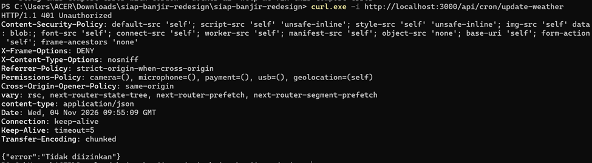

*Gambar 39 Endpoint Cron Menolak Permintaan tanpa Secret*

**Hasil:** Server merespons HTTP 401 Unauthorized dengan pesan `{"error":"Tidak diizinkan"}` (Gambar 39). Endpoint ini hanya dapat dipicu oleh pemanggil yang menyertakan secret yang benar.

**Uji C8: Data langganan terenkripsi di basis data**

Uji ini memastikan data push subscription tersimpan dalam bentuk terenkripsi.

1. Buka `http://localhost:3000` (bukan port 8443, agar service worker dapat terdaftar tanpa kendala sertifikat), pilih sebuah desa, buka halaman Pengaturan, lalu aktifkan notifikasi.

2. Tekan Kirim notifikasi uji. Notifikasi yang masuk menunjukkan server berhasil mendekripsi data langganan untuk mengirim notifikasi.

3. Tampilkan isi kolom data langganan di basis data.

   ```powershell
   docker compose exec db psql -U siapbanjir -d siapbanjir -c "SELECT id_langganan, push_subscription FROM langganan_notifikasi;"
   ```

   **Fungsi:** Menampilkan kolom `push_subscription` pada tabel `langganan_notifikasi`.

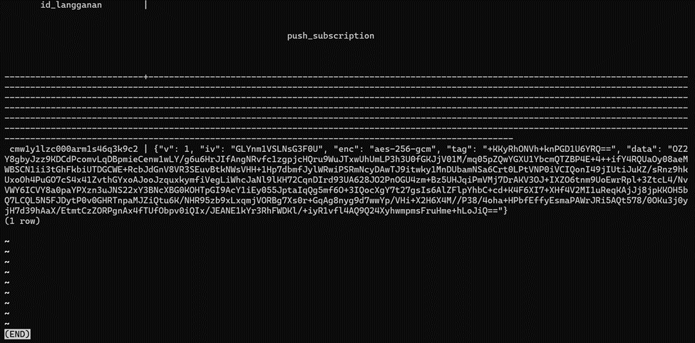

*Gambar 40 Isi Kolom push_subscription di Basis Data*

**Hasil:** Kolom `push_subscription` berisi objek terenkripsi dengan field v (versi format), iv (initialization vector), enc (algoritma aes-256-gcm), tag (authentication tag GCM), dan data (ciphertext) (Gambar 40). Endpoint dan kunci perangkat tidak dapat dibaca langsung dari basis data.

## 3. Security Integrity

Integrity berarti data tidak diubah oleh pihak yang tidak berwenang dan setiap masukan sesuai dengan format yang diharapkan.

**A. Rancangan dan Konfigurasi**

Pengamanan integritas dipasang berlapis pada endpoint API sebagai berikut.

- Pemeriksaan asal permintaan. Fungsi `asalSama` menolak permintaan yang header Origin-nya berasal dari situs lain, sehingga mencegah serangan cross-site request forgery (CSRF).

- Pemeriksaan Content-Type. Endpoint yang menerima data hanya menerima `application/json`.

- Validasi isi permintaan dengan skema Zod. Data yang tidak sesuai skema ditolak sebelum diproses, dan endpoint push subscription hanya diterima dari push service browser yang dikenal.

- Validasi parameter. Kode wilayah harus mengikuti format kode Kemendagri, sehingga masukan berisi pola injeksi ditolak sebelum mencapai basis data.

- Enkripsi AES-256-GCM pada data langganan menyertakan authentication tag, sehingga perubahan ciphertext terdeteksi saat dekripsi (Uji C1).

**B. Pengujian**

**Uji I1: Unit test pemeriksaan asal permintaan**

Uji ini memastikan fungsi `asalSama` membedakan permintaan dari situs sendiri dan dari situs lain.

1. Jalankan unit test pemeriksaan asal di dalam container aplikasi.

   ```powershell
   docker compose exec app npx vitest run tests/unit/asal.test.ts
   ```

   **Fungsi:** Menjalankan berkas tes `asal.test.ts` dengan Vitest di dalam container app.

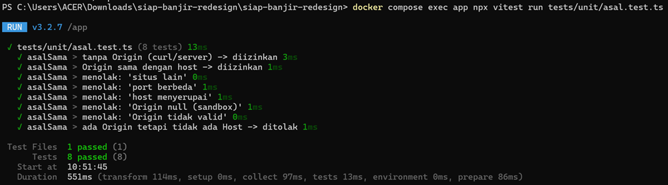

*Gambar 41 Hasil Unit Test Pemeriksaan Asal Permintaan*

**Hasil:** Kedelapan tes lulus (Gambar 41). Permintaan tanpa header Origin (misalnya dari curl atau server) dan permintaan dengan Origin yang sama dengan host diizinkan. Permintaan dari situs lain, port berbeda, host yang menyerupai, Origin null dari sandbox, Origin tidak valid, serta permintaan yang memiliki Origin tetapi tanpa header Host ditolak.

**Uji I2: Content-Type salah**

Uji ini memastikan endpoint menolak data yang bukan JSON.

1. Kirim permintaan dengan Content-Type teks biasa.

   ```powershell
   curl.exe -i -X POST http://localhost:3000/api/push/unsubscribe -H "Content-Type: text/plain" -d "x"
   ```

   **Fungsi:** Mengirim permintaan POST (-X POST) ke endpoint berhenti berlangganan dengan header Content-Type: `text/plain` (-H) dan isi teks x (-d).

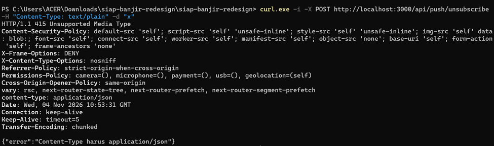

*Gambar 42 Respons 415 untuk Content-Type yang Salah*

**Hasil:** Server menolak dengan HTTP 415 Unsupported Media Type dan pesan Content-Type harus `application/json` (Gambar 42).

**Uji I3: Body tidak valid**

Uji ini memastikan data JSON yang tidak sesuai skema ditolak.

1. Kirim JSON kosong tanpa field yang diwajibkan.

   ```powershell
   curl.exe -i -X POST http://localhost:3000/api/push/unsubscribe -H "Content-Type: application/json" -d "{}"
   ```

   **Fungsi:** Mengirim JSON yang formatnya benar tetapi kosong, tanpa field endpoint yang diwajibkan.

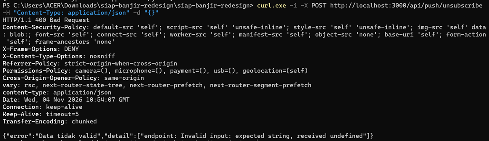

*Gambar 43 Respons 400 untuk Isi Permintaan yang Tidak Valid*

**Hasil:** Server menolak dengan HTTP 400 Bad Request. Bagian detail menyebutkan field yang bermasalah, yaitu endpoint yang seharusnya berupa string tetapi tidak dikirim (Gambar 43).

**Uji I4: Origin palsu**

Uji ini menyimulasikan serangan CSRF, yaitu permintaan yang dikirim dari situs lain.

1. Kirim permintaan dengan header Origin dari situs lain.

   ```powershell
   curl.exe -i -X POST http://localhost:3000/api/push/unsubscribe -H "Origin: https://evil.example" -H "Content-Type: application/json" -d "{}"
   ```

   **Fungsi:** Mengirim permintaan POST dengan header Origin palsu https://evil.example, seolah-olah berasal dari situs lain.

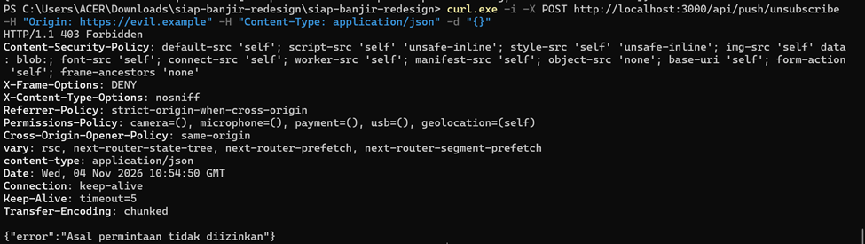

*Gambar 44 Respons 403 untuk Origin Palsu*

**Hasil:** Server menolak dengan HTTP 403 Forbidden dan pesan Asal permintaan tidak diizinkan (Gambar 44). Isi permintaannya sama dengan Uji I3, tetapi responsnya 403, bukan 400. Artinya, pemeriksaan asal dijalankan sebelum isi permintaan diproses.

**Uji I5: Input mencurigakan**

Uji ini memastikan parameter berisi pola injeksi SQL ditolak.

1. Kirim parameter wilayah berisi pola injeksi SQL.

   ```powershell
   curl.exe -i "http://localhost:3000/api/cuaca?wilayah=1%27%20OR%20%271%27%3D%271"
   ```

   **Fungsi:** Mengirim parameter wilayah berisi `1' OR '1'='1` dalam bentuk URL-encoded. Pola ini biasa dipakai untuk menguji celah injeksi SQL.

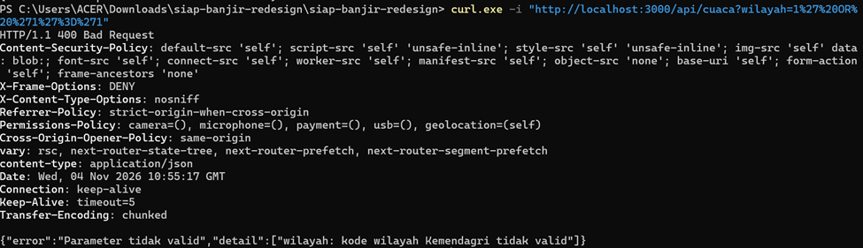

*Gambar 45 Respons 400 untuk Parameter Berisi Pola Injeksi SQL*

**Hasil:** Server menolak dengan HTTP 400 Bad Request dan pesan kode wilayah Kemendagri tidak valid (Gambar 45). Masukan ditolak oleh validasi format sebelum mencapai basis data.

---

# Kontribusi Anggota

Tabel 16 memuat pembagian kerja setiap anggota kelompok dalam penyusunan dokumen requirements ini.

*Tabel 16 Kontribusi Anggota Kelompok*

| **No** | **Nama**             | **NIM**             | **Bagian yang Dikerjakan**                                                                                                                          |
|--------|----------------------|---------------------|-----------------------------------------------------------------------------------------------------------------------------------------------------|
| 1      | Assyfa Rasida Hanum  | 26/585801/PPA/07339 | Menyusun Perancangan UML (Use Case Diagram, Class Diagram, Sequence Diagram, Activity Diagram, dan State Machine Diagram beserta deskripsinya).     |
| 2      | Xerxes Surya Fortuna | 26/589506/PPA/07361 | Menyusun Kebutuhan Fungsional (User Story, Acceptance Criteria, Functional Requirements) dan Aturan Penentuan Level Risiko.                         |
| 3      | Hedi Suryadi         | 26/590863/PPA/07419 | Menyusun Moore’s Vision, Ruang Lingkup Fitur (In-Scope & Out-of-Scope), serta analisis Persona, Skenario, dan Narasi Pengguna.                      |
| 4      | Akbar Syah Rianto    | 26/591436/PPA/07451 | Menyusun Perancangan Arsitektur (Component Diagram, Deployment Diagram, Gaya Arsitektur), Kebutuhan Non-Fungsional (NFR), dan Matriks Traceability. |

---

# Daftar Pustaka

Badan Meteorologi, Klimatologi, dan Geofisika. (2025, 12 September). Cuaca ekstrem masih mengintai, BMKG ingatkan kesiapsiagaan nasional \[Siaran pers\]. https://www.bmkg.go.id/siaran-pers/cuaca-ekstrem-masih-mengintai-bmkg-ingatkan-kesiapsiagaan-nasional

Brooke, J. (1996). SUS: A “quick and dirty” usability scale. Dalam P. W. Jordan, B. Thomas, B. A. Weerdmeester, & I. L. McClelland (Ed.), Usability evaluation in industry (hlm. 189-194). Taylor & Francis.

Eidson, B., & Simmons, J. (2023, 16 Februari). Web push for web apps on iOS and iPadOS. WebKit Blog. https://webkit.org/blog/13878/web-push-for-web-apps-on-ios-and-ipados/

ISO/IEC. (2011). ISO/IEC 25010:2011 Systems and software engineering, Systems and software Quality Requirements and Evaluation (SQuaRE), System and software quality models. International Organization for Standardization.

Moore, G. A. (2014). Crossing the chasm (Edisi ke-3). HarperBusiness.

Open-Meteo. (t.t.-a). Global flood API. Diakses 30 September 2026, dari https://open-meteo.com/en/docs/flood-api

Open-Meteo. (t.t.-b). Weather forecast API. Diakses 30 September 2026, dari https://open-meteo.com/en/docs

Sauro, J. (2011). A practical guide to the System Usability Scale: Background, benchmarks & best practices. Measuring Usability LLC.

Tempo.co. (t.t.). Selalu disebut dalam prakiraan cuaca BMKG, apa beda hujan ringan, sedang, dan berat? Diakses 30 September 2026, dari https://www.tempo.co/lingkungan/selalu-disebut-dalam-prakiraan-cuaca-bmkg-apa-beda-hujan-ringan-sedang-dan-berat--62326

Thomson, M., Damaggio, E., & Raymor, B. (2016). Generic event delivery using HTTP push (RFC 8030). Internet Engineering Task Force. https://www.rfc-editor.org/rfc/rfc8030

Thomson, M., & Beverloo, P. (2017). Voluntary Application Server Identification (VAPID) for Web Push (RFC 8292). Internet Engineering Task Force. [https://www.rfc-editor.org/rfc/rfc8292](https://www.rfc-editor.org/rfc/rfc8292)

---

# Lampiran

1.  UseCase Diagram : [UseCase_SiapBanjir_3aktor.png](https://drive.google.com/file/d/1qCQi8-1f5u5OoGgmzTJBieOAZ4IZs_sk/view?usp=drive_link)

2.  Class Diagram : [Blank diagram (22).png](https://drive.google.com/file/d/1nRPxTXDvCg036xq67mg9H6Rnc4HgxMoW/view?usp=sharing)

3.  Sequence Diagram : [Sequence_Diagram_SiapBanjir_VersiLama_2 (1).png](https://drive.google.com/file/d/1M1KFfWWqjbASns4i7ObhA7rIm2-VG0sb/view?usp=drive_link)

4.  Activity Diagram : [Activity_SiapBanjir_3swimlane_1.png](https://drive.google.com/file/d/1zlyJiXmrV9yy8MAZTO-JQSKR6MNg1TDi/view?usp=drive_link)

5.  State Machine Diagram : [state_machine.png](https://drive.google.com/file/d/1b1l09VesDIWePLWW-9EdnPAvqYavUyPR/view?usp=sharing)

6.  Component Diagram : [Component Diagram.png](https://drive.google.com/file/d/1I4ShPuEYoyFgUqRHBmaNR8BJvG1TwrQE/view?usp=sharing)

7.  Deployment Diagram : [Deployment Diagram.png](https://drive.google.com/file/d/1CSBBsdJGU7MDT4kzJQ9GbYrYKDUtXO61/view?usp=sharing)
